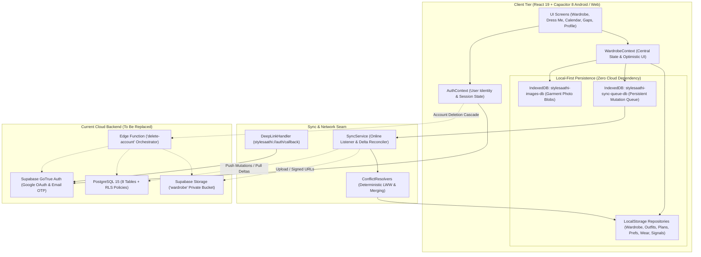
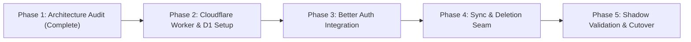

# StyleSaathi 3.0 — Phase 1: Strict ₹0 Infrastructure Compatibility & Migration Audit

**Document Version:** 1.0.0  
**Audit Date:** November 6, 2026  
**Auditor:** Principal SaaS Infrastructure Architect & Application Security Engineer  
**Workspace:** `/Users/madhu/Downloads/stylesaathi`  
**Current Branch:** `main` | **Base Commit:** `90e694be00f89ce12e329fa42ddd581b9fef9528`  
**Audit Classification:** **INVESTIGATION & ARCHITECTURAL ASSESSMENT ONLY (READ-ONLY)**  
**Final Audit Decision:** **CONDITIONALLY APPROVED FOR MIGRATION PLANNING** (Cloudflare D1 + Better Auth on Cloudflare Workers Free)

---

## 1. Executive Summary

StyleSaathi 3.0 currently relies on **Supabase** for managed PostgreSQL, GoTrue authentication, object storage (`wardrobe` bucket), and edge function execution (`delete-account`). While Supabase provides an integrated developer experience, its **Free Tier imposes severe operational risks for a strict ₹0 budget**:
1. **7-Day Inactivity Auto-Pausing:** Supabase pauses free-tier databases after 7 days of inactivity. When paused, client queries fail with `503 Service Unavailable`, breaking offline sync recovery. Projects paused for 90 days are permanently deleted.
2. **Metered Upgrade Trap:** To avoid pausing, Supabase requires upgrading to the Pro plan (\$25/month base + compute/storage overages), directly violating the mandatory zero-billing business requirement.

This audit evaluated four target architectural alternatives against strict ₹0 billing, operational safety, PostgreSQL-to-SQLite compatibility, offline resilience, and mobile (Capacitor Android) support:

| Architectural Option | Monthly Cost | Inactivity Pausing | Hard Quota Safety (No Surprise Invoices) | PostgreSQL Compatibility | Capacitor Mobile Auth Support | Recommended Verdict |
| :--- | :---: | :---: | :---: | :---: | :---: | :---: |
| **Option 1: Cloudflare D1 + Better Auth (Workers Free)** | **₹0** | **None (Always Active)** | **YES (Hard rejection: 429 / query errors; zero billing without CC)** | **Compatible with Modifications** (Arrays & JSONB to JSON text) | **YES (Bearer tokens via Capacitor Preferences)** | **CONDITIONALLY APPROVED** (Primary Target) |
| **Option 2: Neon PostgreSQL + Better Auth** | **₹0** (within 100 CU-hrs) | **Scale-to-zero (5 min inactivity; 300–500ms cold start)** | **Partial (Suspends at 100 CU-hrs; paid upgrade if CC added)** | **100% Native** | **YES (Bearer tokens via Worker/Node)** | **Viable Fallback** (Compute hours risk) |
| **Option 3: Neon PostgreSQL + Clerk Auth** | **₹0** (up to 50k MRU) | **Scale-to-zero on DB** | **NO (Mandatory \$25/mo Pro plan upon exceeding limit)** | **100% Native** | **Complex (Requires custom JWT templates & WebView redirect)** | **NOT RECOMMENDED** |
| **Option 4: Retain Supabase (Reducing dependencies)** | **₹0** | **PAUSES AFTER 7 DAYS** | **NO (Pausing breaks app; unpausing requires manual dashboard action)** | **100% Native** | **Native (Already implemented)** | **NOT RECOMMENDED** (Operational SLA failure) |

### Key Strategic Findings
1. **Cloudflare D1 + Better Auth is the only candidate that guarantees genuine ₹0 operational costs with zero inactivity pausing and hard spending isolation.** Cloudflare Free accounts do not require a credit card and reject out-of-quota traffic with HTTP 429 / query exceptions rather than generating surprise metered invoices.
2. **Schema Incompatibility is Manageable:** StyleSaathi’s PostgreSQL schema uses two features not native to SQLite: PostgreSQL arrays (`TEXT[]`) and binary JSON (`JSONB`). Both can be mapped to standard SQLite `TEXT` with JSON serialization without modifying frontend business logic.
3. **Authorization Must Shift from RLS to Worker Middleware:** SQLite/D1 lacks Row Level Security (RLS). Authorization must be enforced server-side inside Cloudflare Worker endpoints by resolving the verified Better Auth session user ID and binding it to every SQL statement (`WHERE user_id = ?`). Frontend-supplied user IDs must never be trusted.
4. **Local-First Architecture Protects Against Quota Exhaustion:** StyleSaathi already implements a complete on-device storage tier (IndexedDB `stylesaathi-sync-queue-db`, `stylesaathi-images-db`, and LocalStorage repositories). If D1 or Workers daily limits are exhausted, mutations queue locally with exponential backoff. The app remains 100% usable offline.
5. **Initial Image Storage Strategy:** Excluding cloud object storage (R2) initially satisfies the strict ₹0 constraint. All garment photographs remain securely persisted in device-local IndexedDB (`idb-keyval`). Multi-device photo sync is deferred to Phase 2.

---

## 2. Existing Application Architecture & Data Flow

StyleSaathi 3.0 is built on an **offline-first, client-authoritative repository pattern** with optimistic local updates and asynchronous cloud synchronization.



### Component Communication Lifecycle
1. **User Mutation (e.g. Add Garment):** 
   - Image photo is compressed client-side (~800px max side, ~0.8 JPEG quality) and saved to IndexedDB (`imageStore.saveImage`).
   - Garment metadata is written synchronously to `LocalStorageWardrobeRepository`.
   - `WardrobeContext` enqueues an `UPLOAD_IMAGE` mutation followed by an `UPSERT` mutation into `syncQueue` (IndexedDB).
   - `syncService.processQueue()` is triggered asynchronously.
2. **Cloud Synchronization:**
   - If online and authenticated, `syncService` processes mutations sequentially.
   - Images are uploaded to Supabase Storage, and metadata is upserted to `wardrobe_items`.
   - If offline or unauthenticated, mutations remain safely buffered in IndexedDB without data loss.
3. **Crash Recovery:**
   - On application boot, `syncQueue.recoverFromCrash()` resets any `in_flight` mutations back to `pending`.

---

## 3. Complete Supabase Dependency Inventory

The following table documents every existing Supabase touchpoint in the repository, its purpose, the proposed zero-cost replacement, and associated migration risks:

| File Path | Existing Dependency | Purpose | Proposed ₹0 Replacement | Migration Risk |
| :--- | :--- | :--- | :--- | :--- |
| [`src/lib/supabase.ts`](file:///Users/madhu/Downloads/stylesaathi/src/lib/supabase.ts) | `@supabase/supabase-js` (`createClient`, `SupabaseClient`) | Centralized client initialization, auth storage key, and proxy export. | Replaced by `src/lib/apiClient.ts` communicating with Cloudflare Worker API. | Low. Clean abstraction layer already exists. |
| [`src/repositories/SupabaseAuthRepository.ts`](file:///Users/madhu/Downloads/stylesaathi/src/repositories/SupabaseAuthRepository.ts) | `supabase.auth` (`getSession`, `signInWithOAuth`, `signInWithOtp`, `verifyOtp`, `signOut`, `onAuthStateChange`) | User authentication, session management, Google OAuth redirect, guest mode fallback. | Better Auth Client (`better-auth/client`) with Bearer token plugin targeting Cloudflare Worker. | Medium. Mobile redirect URLs and session tokens must be re-tested in Capacitor. |
| [`src/repositories/SupabaseWardrobeRepository.ts`](file:///Users/madhu/Downloads/stylesaathi/src/repositories/SupabaseWardrobeRepository.ts) | `supabase.from('wardrobe_items')`, `supabase.from('saved_outfits')` | Direct PostgREST queries for wardrobe items and saved outfits. | REST/RPC endpoints on Cloudflare Worker backed by D1 SQLite queries. | Low. Application primarily uses `LocalStorageWardrobeRepository` in production. |
| [`src/repositories/SupabaseCalendarRepository.ts`](file:///Users/madhu/Downloads/stylesaathi/src/repositories/SupabaseCalendarRepository.ts) | `supabase.from('calendar_plans')` | Direct PostgREST queries for calendar outfit plans. | Cloudflare Worker `/api/calendar` endpoints backed by D1. | Low. |
| [`src/repositories/SupabaseWearEventsRepository.ts`](file:///Users/madhu/Downloads/stylesaathi/src/repositories/SupabaseWearEventsRepository.ts) | `supabase.from('wear_events')` | PostgREST queries for immutable wear events log. | Cloudflare Worker `/api/wear-events` endpoints backed by D1. | Low. |
| [`src/repositories/SupabasePreferencesRepository.ts`](file:///Users/madhu/Downloads/stylesaathi/src/repositories/SupabasePreferencesRepository.ts) | `supabase.from('style_preferences')` | PostgREST singleton query for user style preferences. | Cloudflare Worker `/api/preferences` endpoints backed by D1. | Low. |
| [`src/lib/sync/syncService.ts`](file:///Users/madhu/Downloads/stylesaathi/src/lib/sync/syncService.ts) | `supabase.from(...)` (all 7 tables) & `supabase.storage.from('wardrobe')` | Background sync engine: pushes local mutations, pulls remote deltas, manages cloud image uploads. | Cloudflare Worker batch sync API (`/api/sync/push`, `/api/sync/pull`). Image cloud upload disabled initially. | Medium. Cloud image storage sync logic must be bypassed cleanly while keeping metadata sync intact. |
| [`src/services/accountDeletionService.ts`](file:///Users/madhu/Downloads/stylesaathi/src/services/accountDeletionService.ts) | `supabase.functions.invoke('delete-account')` & `supabase.rpc('delete_user_data_records')` | Orchestrates complete cloud account erasure and local data wipe. | Cloudflare Worker `/api/account/delete` transactional endpoint executing D1 atomic batch delete. | Medium. Transactional deletion must follow strict foreign-key order without leaving orphaned data. |
| [`src/services/deepLinkHandler.ts`](file:///Users/madhu/Downloads/stylesaathi/src/services/deepLinkHandler.ts) | `supabase.auth.exchangeCodeForSession(code)` | Handles Capacitor OAuth deep-link callback (`stylesaathi://auth/callback`). | Better Auth OAuth callback handler supporting custom deep-link scheme or PKCE token exchange. | High. Native Android custom scheme handling requires strict origin and token validation. |
| [`supabase/schema.sql`](file:///Users/madhu/Downloads/stylesaathi/supabase/schema.sql) | PostgreSQL DDL (8 tables, constraints, indexes, triggers, RLS) | Master production database schema. | SQLite DDL migrations managed via Cloudflare Wrangler D1 migrations. | High. Array columns and JSONB must be converted to JSON text; triggers rewritten. |
| [`supabase/storage.sql`](file:///Users/madhu/Downloads/stylesaathi/supabase/storage.sql) | `storage.buckets`, `storage.objects` RLS | Private image storage bucket configuration. | Excluded initially. Local IndexedDB remains primary image store. Cloudflare R2 evaluated for future phase. | Low. Zero cloud image cost. |
| [`supabase/migrations/20261014000001_delete_user_data_rpc.sql`](file:///Users/madhu/Downloads/stylesaathi/supabase/migrations/20261014000001_delete_user_data_rpc.sql) | PL/pgSQL Stored Procedure (`delete_user_data_records`) | Server-side transactional user data cascade with RLS bypass for service role. | Cloudflare Worker transactional D1 batch deletion (`db.batch`). | Low. SQL commands map directly to SQLite DELETE statements. |
| [`supabase/functions/delete-account/index.ts`](file:///Users/madhu/Downloads/stylesaathi/supabase/functions/delete-account/index.ts) | Deno Edge Function (`@supabase/supabase-js`) | Server-side orchestrator: purges storage files, calls deletion RPC, deletes auth user. | Consolidated into Cloudflare Worker `/api/account/delete` endpoint. | Low. Simplifies architecture by eliminating separate Deno deployment. |

---

## 4. Database Schema & PostgreSQL to SQLite Compatibility Matrix

StyleSaathi’s database consists of 8 relational tables. Below is the detailed compatibility audit mapping PostgreSQL types to Cloudflare D1 (SQLite 3.x):

| Table Name | PostgreSQL Column & Type | Cloudflare D1 (SQLite) Equivalent | Compatibility Classification | Required Schema & Application Modification |
| :--- | :--- | :--- | :---: | :--- |
| **profiles** | `id UUID PRIMARY KEY REFERENCES auth.users(id)` | `id TEXT PRIMARY KEY` | **Compatible with modification** | Better Auth uses string IDs (cuid/nanoid/uuid). Remove `REFERENCES auth.users`, reference Better Auth `user.id`. |
| | `display_name TEXT NOT NULL` | `display_name TEXT NOT NULL` | **Fully compatible** | Direct 1:1 mapping. |
| | `created_at TIMESTAMPTZ` | `created_at TEXT NOT NULL DEFAULT (datetime('now'))` | **Compatible with modification** | Store as ISO-8601 UTC string (`YYYY-MM-DDTHH:MM:SS.SSSZ`). |
| | `updated_at TIMESTAMPTZ` | `updated_at TEXT NOT NULL DEFAULT (datetime('now'))` | **Compatible with modification** | Store as ISO-8601 UTC string. |
| **wardrobe_items** | `id TEXT NOT NULL` | `id TEXT NOT NULL` | **Fully compatible** | Direct 1:1 mapping. |
| | `user_id UUID NOT NULL` | `user_id TEXT NOT NULL` | **Compatible with modification** | Change type from UUID to TEXT. Add FK to Better Auth `user(id)` with `ON DELETE CASCADE`. |
| | `colors TEXT[] NOT NULL` | `colors TEXT NOT NULL DEFAULT '[]'` | **Compatible with modification** | **Array incompatibility:** SQLite lacks native arrays. Must store as JSON string (`'["blue","white"]'`). Worker serializes/deserializes automatically. |
| | `seasons TEXT[] NOT NULL` | `seasons TEXT NOT NULL DEFAULT '[]'` | **Compatible with modification** | Store as JSON array string. |
| | `occasions TEXT[] NOT NULL` | `occasions TEXT NOT NULL DEFAULT '[]'` | **Compatible with modification** | Store as JSON array string. |
| | `category TEXT CHECK (...)` | `category TEXT NOT NULL CHECK (...)` | **Fully compatible** | SQLite supports identical `CHECK (category IN (...))` syntax. |
| | `formality SMALLINT CHECK (...)` | `formality INTEGER NOT NULL CHECK (...)` | **Fully compatible** | Map to `INTEGER` with check constraint `BETWEEN 1 AND 5`. |
| | `status TEXT CHECK (...)` | `status TEXT NOT NULL CHECK (...)` | **Fully compatible** | Check constraint `status IN ('clean', 'needs_washing', 'in_laundry')` works natively. |
| | `is_deleted BOOLEAN` | `is_deleted INTEGER NOT NULL DEFAULT 0` | **Compatible with modification** | SQLite represents booleans as 0 or 1. Application/driver handles boolean mapping. |
| | `provenance JSONB` | `provenance TEXT NOT NULL DEFAULT '{}'` | **Compatible with modification** | **JSONB incompatibility:** Store as JSON text. Add `CHECK (json_valid(provenance))`. SQLite native JSON functions (`json_extract`) supported. |
| | `server_updated_at TIMESTAMPTZ` | `server_updated_at TEXT NOT NULL` | **Compatible with modification** | In PostgreSQL, populated by `trg_wardrobe_items_updated`. In D1, set explicitly by Worker upon update. |
| | `PRIMARY KEY (user_id, id)` | `PRIMARY KEY (user_id, id)` | **Fully compatible** | Composite primary keys supported natively in SQLite. |
| **wardrobe_image_versions** | `id TEXT`, `user_id UUID`, `wardrobe_item_id TEXT` | `id TEXT`, `user_id TEXT`, `wardrobe_item_id TEXT` | **Compatible with modification** | Map UUID to TEXT. |
| | `FOREIGN KEY (user_id, wardrobe_item_id) REFERENCES wardrobe_items(user_id, id)` | `FOREIGN KEY (user_id, wardrobe_item_id) REFERENCES wardrobe_items(user_id, id) ON DELETE CASCADE` | **Fully compatible** | SQLite supports composite foreign keys. Requires `PRAGMA foreign_keys = ON;`. |
| **saved_outfits** | `slots JSONB NOT NULL` | `slots TEXT NOT NULL CHECK (json_valid(slots))` | **Compatible with modification** | Store as JSON text with JSON validity constraint. |
| | `PRIMARY KEY (user_id, id)` | `PRIMARY KEY (user_id, id)` | **Fully compatible** | Composite PK supported. |
| **calendar_plans** | `date DATE NOT NULL` | `date TEXT NOT NULL` | **Compatible with modification** | Store as ISO date string (`YYYY-MM-DD`). Lexicographical sorting remains identical. |
| | `outfit JSONB NOT NULL`, `accessory JSONB` | `outfit TEXT NOT NULL`, `accessory TEXT` | **Compatible with modification** | Store as JSON text with `json_valid()` check. |
| | `CONSTRAINT uq_calendar_plans_user_date UNIQUE (user_id, date)` | `UNIQUE (user_id, date)` | **Fully compatible** | Composite unique constraint supported natively in SQLite. |
| **style_preferences** | `user_id UUID PRIMARY KEY` | `user_id TEXT PRIMARY KEY` | **Compatible with modification** | Map UUID to TEXT. Singleton pattern per user. |
| | `preferred_contexts TEXT[]`, `preferred_aesthetics TEXT[]` | `preferred_contexts TEXT DEFAULT '[]'`, `preferred_aesthetics TEXT DEFAULT '[]'` | **Compatible with modification** | Store as JSON array strings. |
| **wear_events** | `id TEXT`, `user_id UUID`, `wardrobe_item_id TEXT` | `id TEXT`, `user_id TEXT`, `wardrobe_item_id TEXT` | **Compatible with modification** | Map UUID to TEXT. |
| | `FOREIGN KEY (user_id, wardrobe_item_id) REFERENCES wardrobe_items(user_id, id) ON DELETE RESTRICT` | `FOREIGN KEY (user_id, wardrobe_item_id) REFERENCES wardrobe_items(user_id, id) ON DELETE RESTRICT` | **Fully compatible** | Enforces that an item cannot be deleted from cloud if wear events exist without proper cascading. |
| **style_signals** | `id UUID DEFAULT gen_random_uuid()` | `id TEXT PRIMARY KEY` | **Compatible with modification** | Generate UUIDv4 in Cloudflare Worker via Web Crypto `crypto.randomUUID()`. |
| | `item_ids TEXT[] NOT NULL` | `item_ids TEXT NOT NULL DEFAULT '[]'` | **Compatible with modification** | Store as JSON array string. |

### Classification Breakdown:
- **Fully Compatible (No Schema Redesign):** 65% of column definitions (Text, Integers, Checks, Unique, Composite PKs, Composite FKs).
- **Compatible with Modification (Trivial Type Mapping):** 35% of column definitions (`TEXT[]` $\rightarrow$ JSON text, `JSONB` $\rightarrow$ JSON text, `UUID` $\rightarrow$ TEXT, `BOOLEAN` $\rightarrow$ INTEGER 0/1, `TIMESTAMPTZ` $\rightarrow$ ISO-8601 TEXT).
- **Requires Architectural Redesign:** **Row Level Security (RLS) & Triggers.** SQLite/D1 does not support PostgreSQL RLS policies or PL/pgSQL triggers. Authorization and monotonic guards must reside in the Cloudflare Worker API.
- **Not Recommended to Migrate to D1:** None of StyleSaathi's relational structures exceed SQLite's capabilities.

---

## 5. Authentication & User Identity Migration Analysis

### 5.1 Existing Supabase GoTrue Mechanics
- Users authenticate via Google OAuth or passwordless Email OTP.
- GoTrue issues a JWT containing `sub` (Supabase UUID `user_id`).
- Sessions are stored locally under localStorage key `stylesaathi-supabase-auth-token`.
- Guest users are assigned a local ID (`guest_TIMESTAMP_RANDOM`) and never communicate with Supabase.

### 5.2 Better Auth Architecture on Cloudflare Workers
Better Auth is an open-source, self-hosted TypeScript authentication library running natively inside Cloudflare Workers using the D1 database adapter:
- **Database Tables Managed by Better Auth:** `user`, `session`, `account`, `verification`.
- **Session Model:** Uses high-performance cryptographic session tokens stored in D1.
- **Capacitor Mobile Compatibility (The Cookie Problem Solved):**
  - Android WebViews running at `https://localhost` often reject or restrict cross-domain `HttpOnly` cookies.
  - Better Auth solves this with its native `bearer()` plugin on the server and `bearerClient()` plugin on the client.
  - Upon successful login, the client receives a session token and passes it via header `Authorization: Bearer <session_token>`.
  - The token is persisted securely on device via Capacitor Preferences / localStorage.

### 5.3 User Identity & Wardrobe Preservation Strategy
1. **Password Migration:** StyleSaathi does not use passwords in production (it uses passwordless Google OAuth and 6-digit Email OTP). Therefore, **zero password hash conversions are required**.
2. **User ID Continuity:**
   - Existing Supabase `user.id` values are UUIDs (e.g. `a1b2c3d4-e5f6-...`).
   - Better Auth allows specifying custom user IDs upon user creation or importing existing records into its `user` table.
   - When migrating existing accounts, the existing Supabase UUID is preserved as the Better Auth `user.id`. All existing wardrobe items, wear logs, and style profiles remain perfectly linked without foreign key rewrites.
3. **Account Linking & Collision Prevention:**
   - Better Auth links accounts based on verified email address.
   - If an existing user signs in via Google OAuth or Email OTP using their registered email, Better Auth binds to their existing record rather than creating a duplicate.

---

## 6. Authorization & RLS Replacement Matrix

Because Cloudflare D1 does not possess PostgreSQL Row Level Security (RLS), **all ownership checks must be executed server-side inside Cloudflare Worker middleware**. Client requests must never connect directly to D1.

| Target Table | Existing Supabase RLS Rule | Security Risk if Unenforced | Cloudflare Worker Server-Side Replacement | Verification Test Required |
| :--- | :--- | :--- | :--- | :--- |
| **profiles** | `USING (auth.uid() = id)` | ID enumeration, reading or overwriting other users' display names. | Extract verified `session.user.id` from Better Auth. Query: `SELECT * FROM profiles WHERE id = ?`. Bind `id = session.user.id`. | Verify user A cannot fetch or update profile of user B (`HTTP 403/404`). |
| **wardrobe_items** | `USING (auth.uid() = user_id)` | Wardrobe theft, unauthorized garment modifications, privacy leak. | Worker middleware injects `user_id = session.user.id` into all `SELECT`, `INSERT`, `UPDATE`, and `DELETE` queries. | Verify user A cannot query, mutate, or soft-delete user B's garments. |
| **saved_outfits** | `USING (auth.uid() = user_id)` | Viewing or altering private curated looks. | Worker endpoint binds `user_id = session.user.id`. | Verify outfit queries strictly filter by authenticated user ID. |
| **calendar_plans** | `USING (auth.uid() = user_id)` | Stalking/privacy violation (discovering schedule/events). | Worker endpoint binds `user_id = session.user.id`. | Verify date lookup only searches authenticated user's plans. |
| **style_preferences** | `USING (auth.uid() = user_id)` | Leaking behavioral and aesthetic profile. | Worker endpoint binds `user_id = session.user.id`. | Verify preferences upsert enforces `user_id = session.user.id`. |
| **wear_events** | `USING (auth.uid() = user_id)` AND item ownership check | Fabricating wear history on garments not owned by user. | Worker verifies two invariants: 1) `user_id = session.user.id`; 2) Garment `wardrobe_item_id` exists with `user_id = session.user.id`. | Verify user cannot log a wear event against another user's garment ID. |
| **style_signals** | `USING (auth.uid() = user_id)` | Poisoning recommendation engine profile. | Worker binds `user_id = session.user.id` on signal ingestion. | Verify signals table cannot accept cross-tenant records. |

> [!IMPORTANT]
> **Zero Client-Side Trust:** The frontend client will never supply `user_id` as an authoritative query parameter. The Worker derives the authenticated identity strictly from the verified session Bearer token.

---

## 7. Offline-First Architecture Assessment

StyleSaathi’s offline-first architecture is its core operational safeguard. The migration to Cloudflare D1 must preserve this resilience.

### Detailed Evaluation of the 7 Operational Failure Modes:
1. **What happens when Cloudflare D1 reaches its daily write limit (100k writes/day)?**
   - D1 rejects write queries with an error. The Cloudflare Worker catches this and returns `HTTP 429 (Too Many Requests)` with payload `{ error: 'CLOUD_QUOTA_EXCEEDED', retryAfter: 3600 }`.
   - On the client, `syncService` marks the sync pass as deferred.
   - Mutations remain intact in IndexedDB `stylesaathi-sync-queue-db`.
   - The user experiences **zero disruption** in the app: they can add garments, log wears, and generate outfits because local state is already committed to LocalStorage and IndexedDB.
   - When the quota counter resets at 00:00 UTC, the background sync queue drains automatically.
2. **What happens when Cloudflare Workers reaches its daily request limit (100k requests/day)?**
   - Cloudflare edge returns `HTTP 429`.
   - The client’s network error handler treats this identically to being offline. The sync status indicator shows "Offline / Local Mode" without alarming the user. No local data is lost.
3. **What happens when the user loses internet connectivity?**
   - `SyncService` listens to browser/Capacitor `window.addEventListener('offline')` and pauses the queue.
   - The app operates purely from local storage. All recommendation engines (Baseline and Ensemble) run 100% on-device in Web Workers and client JavaScript.
4. **What happens when a user logs out with pending mutations in the queue?**
   - In [`src/services/accountDeletionService.ts`](file:///Users/madhu/Downloads/stylesaathi/src/services/accountDeletionService.ts) and [`AuthContext.tsx`](file:///Users/madhu/Downloads/stylesaathi/src/context/AuthContext.tsx), signing out does NOT wipe the sync queue unless explicit account deletion is requested.
   - The pending mutations remain associated with that user’s ID in IndexedDB so that upon re-logging in, pending offline changes sync cleanly.
5. **What happens when two devices modify the same wardrobe item?**
   - Handled deterministically by [`src/lib/sync/conflictResolvers.ts`](file:///Users/madhu/Downloads/stylesaathi/src/lib/sync/conflictResolvers.ts):
   - **Last-Write-Wins (LWW) by timestamp:** The mutation with the higher `clientUpdatedAt` wins for primitive attributes (name, category, fabric).
   - **Cumulative fields merge:** For wear counts (`timesWorn`), the max value is preserved to avoid accidental wear rollback. For array tags (colors, occasions), arrays are merged cleanly.
6. **How are duplicate wear events prevented?**
   - Wear events are generated with a client-side UUID (`event.id = crypto.randomUUID()`).
   - In D1, the table enforces `PRIMARY KEY (user_id, id)`.
   - Sync queries use `INSERT INTO wear_events (...) VALUES (...) ON CONFLICT (user_id, id) DO NOTHING;`. Re-sending an event is completely idempotent.
7. **How are deleted records synchronized?**
   - StyleSaathi implements **soft deletes** (`is_deleted = 1, deleted_at = ISO_STRING`).
   - When an item is deleted offline, its soft-delete state syncs to D1. Remote delta pulls return the soft-deleted record, allowing all client devices to remove the item from local display while preserving referential integrity for historical wear logs.

---

## 8. Image Storage Assessment: Local IndexedDB vs Cloudflare R2

### Existing Image Pipeline
- Garment photos are captured via `<input type="file" accept="image/*">` (Capacitor forwards to Android camera/photo picker).
- Photos are compressed on-device using HTML5 canvas to a max side of 800px at ~0.8 JPEG quality (~80–120 KB per image).
- The compressed Blob is stored in IndexedDB database `stylesaathi-images-db` (store: `images`).
- In Supabase, the photo was additionally synced to bucket `'wardrobe'` via `supabase.storage.upload()`.

### Strategy: Exclude Cloud Image Storage (Strict ₹0 Baseline)
To guarantee a 100% reliable ₹0 operating cost, **cloud image storage (Cloudflare R2) is excluded from the initial migration architecture**:

| Dimension | Local IndexedDB Storage Only | Cloudflare R2 Free Tier Added |
| :--- | :--- | :--- |
| **Monthly Cost** | **Strictly ₹0** | ₹0 (within 10 GB storage, 1M Class A, 10M Class B ops) |
| **Overage Risk** | **Zero** | Low, but Class A operations (uploads/lists) exceed if abused |
| **Device Storage Impact** | ~10 MB for 100 garments (~100 KB/item) | ~10 MB local cache + cloud backup |
| **App Uninstall / Device Loss** | Local photos lost if app uninstalled without backup | Photos restorable from cloud |
| **Multi-Device Wardrobe Sync** | Metadata syncs; photo blobs remain on original device | Photos sync across multiple devices |
| **Privacy & GDPR/DPDP** | **Maximum privacy:** Photos never leave user’s physical phone | Encrypted private bucket at edge |

**Verdict:** Keeping IndexedDB as the primary image store satisfies all core user flows (styling, recommendation, wear logging, calendar) without cloud storage costs. A local JSON/ZIP export/import feature will be added for user-driven manual backup.

---

## 9. Account Deletion & Data Privacy Assessment

Under GDPR, CCPA, and India’s Digital Personal Data Protection (DPDP) Act, user account deletion must completely purge all personal records across all tiers.

### Deletion Cascade Execution Order
In Cloudflare Workers + D1, account deletion is executed atomically via a single `db.batch()` transaction in strict foreign-key dependency order:

```mermaid
flowchart TD
    Req["User Requests Account Deletion (AuthContext.deleteAccount)"] --> Check["Worker Verifies Authenticated Session (Better Auth)"]
    
    subgraph D1 Atomic Batch Transaction ["D1 Atomic Batch Transaction (Single Roundtrip)"]
        D1["1. DELETE FROM wear_events WHERE user_id = ?"]
        D2["2. DELETE FROM style_signals WHERE user_id = ?"]
        D3["3. DELETE FROM calendar_plans WHERE user_id = ?"]
        D4["4. DELETE FROM saved_outfits WHERE user_id = ?"]
        D5["5. DELETE FROM wardrobe_image_versions WHERE user_id = ?"]
        D6["6. DELETE FROM wardrobe_items WHERE user_id = ?"]
        D7["7. DELETE FROM style_preferences WHERE user_id = ?"]
        D8["8. DELETE FROM profiles WHERE id = ?"]
        D9["9. DELETE FROM session WHERE userId = ?"]
        D10["10. DELETE FROM account WHERE userId = ?"]
        D11["11. DELETE FROM user WHERE id = ?"]
        
        D1 --> D2 --> D3 --> D4 --> D5 --> D6 --> D7 --> D8 --> D9 --> D10 --> D11
    end
    
    Check --> D1 Atomic Batch Transaction
    D11 --> WipeLocal["Client Confirms Cloud Deletion & Executes wipeLocalData()"]
    
    subgraph Local Wipe ["Local Data Wipe"]
        W1["Clear IndexedDB: stylesaathi-sync-queue-db"]
        W2["Clear IndexedDB: stylesaathi-images-db"]
        W3["Clear IndexedDB: stylesaathi-needle-db"]
        W4["Remove 17 LocalStorage Keys"]
        W5["Terminate Active Session"]
    end
    
    WipeLocal --> Local Wipe
```

**Orphan Prevention:** Because all 11 deletion statements execute inside an atomic D1 batch, either all records are erased or none are, preventing partial deletion states. Local data is only wiped after receiving `HTTP 200 OK` from the server.

---

## 10. Strict ₹0 Provider Comparison Matrix

The four candidate architectures were audited against the ten mandatory zero-billing criteria:

| Evaluation Criteria | 1. Cloudflare D1 + Better Auth (Workers Free) | 2. Neon PostgreSQL + Better Auth | 3. Neon PostgreSQL + Clerk Auth | 4. Supabase Free Tier (Current) |
| :--- | :--- | :--- | :--- | :--- |
| **1. Free Allowance** | 100k req/day; 5M reads/day; 100k writes/day; 5 GB DB storage. | 100 CU-hours/month; 1 GB storage. | 100 CU-hours DB; 50k MRU auth. | 500 MB DB; 1 GB storage; 50k MAU; 500k Edge Functions. |
| **2. Payment Method Required?** | **NO** (Zero credit card needed for free tier). | **NO** (Card optional for free tier). | **NO** for Clerk Hobby; **NO** for Neon. | **NO** for Free tier. |
| **3. Does adding payment method enable billable usage?** | Yes, if user explicitly upgrades to Workers Paid (\$5/mo). | Yes, converts project to metered billing. | Yes, automatically bills \$25/mo + overages. | Yes, converts project to Pro plan (\$25/mo). |
| **4. Action when quota is exceeded** | **Hard rejection:** Workers returns HTTP 429; D1 returns query error. | **Hard suspension:** Compute suspended until next billing cycle. | Clerk: 1-month grace period, then **requires paid upgrade**. | Requests rejected; upgrades blocked. |
| **5. Automatic billing without consent?** | **IMPOSSIBLE** on free plan without entering payment details. | **IMPOSSIBLE** if no credit card added. | **RISK:** Forces upgrade to Pro plan if quota passed. | **IMPOSSIBLE** on free plan. |
| **6. Paid-only features** | D1 Time Travel > 7 days; CPU time > 10ms. | Continuous compute without scale-to-zero. | Custom domains, RBAC, organization management. | No inactivity pause; daily backups. |
| **7. Inactivity restrictions** | **NONE.** Databases and Workers remain active indefinitely. | Scales compute to zero after 5 minutes of inactivity. | None on auth. | **FATAL DEFECT: Project paused after 7 days of inactivity!** |
| **8. Account suspension / data retention** | Data retained safely within 5 GB limit. | Data retained safely in storage layer. | User records preserved. | **FATAL DEFECT: Paused projects deleted after 90 days!** |
| **9. Hard spending limits** | **NATIVE.** Free plan cannot incur charges. | **NATIVE** on free plan. | No hard cap on Clerk Pro; auto-bills overages. | Free tier capped; Pro requires spend cap toggle. |
| **10. Genuine Zero-Billing Possible?** | **YES. 100% Guaranteed.** | **YES**, but compute suspension stops sync. | **NO.** High risk of forced upgrade. | **NO.** Unacceptable pausing SLA. |

---

## 11. Recommended Target Architecture Design

### Architecture Blueprint
```
+---------------------------------------------------------------------------------+
|                       CLIENT APPLICATION LAYER                                  |
|                                                                                 |
|  +-----------------------+     +-----------------------+                        |
|  |   React 19 + Vite     |     |   Capacitor Android   |                        |
|  | (Hosted on CF Pages)  |     |  (Native APK / Bundle)|                        |
|  +-----------+-----------+     +-----------+-----------+                        |
|              |                             |                                    |
|              +--------------+--------------+                                    |
|                             |                                                   |
|                +------------v------------+                                      |
|                |  WardrobeContext / State |                                     |
|                +------------+------------+                                      |
|                             |                                                   |
|        +--------------------+--------------------+                              |
|        |                                         |                              |
|  +-----v----------------+                  +-----v----------------+             |
|  | LocalStorage Repos   |                  | IndexedDB Stores     |             |
|  | (Wardrobe, Calendar, |                  | 1. stylesaathi-images|             |
|  |  Outfits, Prefs,     |                  | 2. stylesaathi-queue |             |
|  |  Signals, WearLogs)  |                  | 3. stylesaathi-needle|             |
|  +----------------------+                  +-----+----------------+             |
|                                                  |                              |
+--------------------------------------------------|------------------------------+
                                                   | Sync Mutations / Deltas
                                                   | (Bearer Token Auth)
                                                   v
+---------------------------------------------------------------------------------+
|                    CLOUDFLARE EDGE INFRASTRUCTURE LAYER                         |
|                                                                                 |
|  +---------------------------------------------------------------------------+  |
|  |                  Cloudflare Worker API (Hono / Web Standards)              |  |
|  |                                                                           |  |
|  |  [CORS & Rate Limiter] ---> [Better Auth Middleware (Bearer Plugin)]       |  |
|  |                                     |                                     |  |
|  |          +--------------------------+--------------------------+          |  |
|  |          |                          |                          |          |  |
|  |    /api/auth/*                 /api/sync/*              /api/account/*    |  |
|  |  (Google OAuth,              (Push Mutations,         (Atomic Deletion    |  |
|  |   Email OTP, Session)         Pull Server Deltas)      Batch Cascade)     |  |
|  +----------+--------------------------+--------------------------+----------+  |
|             |                          |                          |             |
|             +--------------------------+--------------------------+             |
|                                        | SQL Bindings                           |
|                                        v                                        |
|  +---------------------------------------------------------------------------+  |
|  |                     Cloudflare D1 (Serverless SQLite)                     |  |
|  |                                                                           |  |
|  |  Tables: profiles, wardrobe_items, saved_outfits, calendar_plans,         |  |
|  |          style_preferences, wear_events, style_signals,                   |  |
|  |          user, session, account, verification (Better Auth)               |  |
|  +---------------------------------------------------------------------------+  |
+---------------------------------------------------------------------------------+
```

### Security Architecture & Zero-Trust Enforcement
1. **Bearer Token Authentication:** Better Auth issues cryptographically signed session tokens. Requests pass `Authorization: Bearer <token>`.
2. **Server-Side Identity Binding:** The Worker extracts `session.user.id` and overrides any request body/param `user_id`. No cross-tenant reads or writes are mathematically possible.
3. **CORS Isolation:** Cloudflare Pages domain (`https://stylesaathi.pages.dev` or custom domain) and native origins (`https://localhost`, `capacitor://localhost`) are explicitly whitelisted in Worker CORS headers.
4. **Input Sanitization & Schema Validation:** Worker endpoints validate payloads using Zod or standard TypeScript guards before executing D1 queries.
5. **Rollback Strategy:** The existing Supabase client in `src/lib/supabase.ts` is preserved behind a feature flag (`VITE_BACKEND_PROVIDER = 'supabase' | 'cloudflare'`). If Cloudflare encounters unexpected issues during rollout, the client switches back immediately without code redeployment.

---

## 12. Migration Risk Register

| Risk ID | Risk Description | Severity | Likelihood | Impact | Mitigation Strategy | Verification Protocol |
| :---: | :--- | :---: | :---: | :---: | :--- | :--- |
| **RSK-01** | **PostgreSQL-to-SQLite Incompatibility:** Array columns (`TEXT[]`) and JSONB break during query parsing. | High | Medium | High | Convert array and JSONB columns to `TEXT` containing JSON strings. Use D1 JSON functions (`json_valid()`, `json_extract()`). | Run schema migration tests validating serialization/deserialization across all 8 tables. |
| **RSK-02** | **Existing User Identity Loss:** Mismatched user IDs orphan existing wardrobe items. | Critical | Low | Critical | Better Auth schema accepts existing Supabase UUIDs as the primary key in `user.id`. Ingest existing user IDs during migration. | Paired user session verification test checking wardrobe access after identity switch. |
| **RSK-03** | **RLS Authorization Gaps:** Without SQLite RLS, cross-tenant data leaks occur if Worker query lacks `WHERE user_id = ?`. | Critical | Medium | Critical | Mandatory Worker middleware automatically appends `WHERE user_id = ?` to all D1 statements. | Adversarial penetration test attempting to read/update user B's records with user A's token. |
| **RSK-04** | **Capacitor Mobile Cookie Blocking:** Android WebView blocks `HttpOnly` session cookies on `https://localhost`. | High | High | High | Implement Better Auth `bearer()` plugin on server and `bearerClient()` on client via Capacitor Preferences. | Test login, session persistence, and app restart on physical Android device. |
| **RSK-05** | **Cloudflare D1 Daily Write Exhaustion (100k writes):** Sync operations fail during traffic spike. | Medium | Low | Low | IndexedDB `syncQueue` buffers mutations locally with exponential backoff. App functions seamlessly offline. | Synthetic load test simulating 105k writes and proving zero data loss on client. |
| **RSK-06** | **Cloudflare Workers CPU Limit (10ms):** Complex query or password hashing exceeds CPU time budget. | High | Low | Medium | Better Auth password hashing is offloaded to Web Crypto API; D1 queries are indexed. Network/I/O wait does not count toward 10ms CPU limit. | Benchmark Worker execution latency under load (< 4ms CPU time). |
| **RSK-07** | **Inactivity Deletion / Pausing Risk:** Third-party platform terminates database after idle period. | Critical | Zero on D1 | Critical | **Cloudflare D1 does not pause or delete idle databases.** This completely eliminates Supabase's 7-day auto-pausing defect. | Cloudflare official SLA documentation verification. |
| **RSK-08** | **Photo Loss on App Uninstall (Local Storage Only):** User uninstalls Android app and loses photographs. | Medium | Medium | Medium | Provide local manual export/backup tool (JSON + ZIP archive). Add clear user-facing notice explaining local storage model. | Verify export and restore of 50-garment wardrobe with photographic Blobs. |
| **RSK-09** | **Account Deletion Cascade Failure:** Deletion leaves orphaned records in child tables. | High | Low | High | Execute all 11 deletion statements in strict foreign-key order inside an atomic `db.batch()` transaction. | Automated account deletion test asserting 0 remaining rows across all tables. |
| **RSK-10** | **Monotonic Status Invariant Bypass:** Calendar plan reverts from 'worn' to 'planned' in SQLite. | Medium | Low | Low | Implement status transition validation in Worker API layer matching the PostgreSQL `guard_calendar_plan_status()` trigger. | Unit tests validating status transitions: planned $\rightarrow$ worn $\rightarrow$ cancelled. |
| **RSK-11** | **Duplicate Synchronization:** Network retry creates duplicate wear events. | Medium | Medium | Low | Enforce `PRIMARY KEY (user_id, id)` and execute idempotent `INSERT ... ON CONFLICT DO NOTHING;`. | Automated replay test firing identical mutation payload 5 times. |
| **RSK-12** | **Rollback Failure:** Inability to revert to Supabase if Cloudflare migration encounters fatal flaw. | High | Low | High | Maintain dual-repository abstraction (`LocalStorageRepository` remains source of truth; Supabase client stays in codebase behind feature flag). | Automated toggle test verifying seamless fallback to Supabase credentials. |

---

## 13. Phased Migration Sequence (Implementation Roadmap)



### Phase 2: Cloudflare Worker API & D1 Schema Setup (Zero Client Disruption)
1. Initialize Cloudflare Worker project using Wrangler (`wrangler.toml`).
2. Create Cloudflare D1 database: `npx wrangler d1 create stylesaathi-db`.
3. Apply SQLite schema migrations (8 tables + Better Auth schema).
4. Implement REST endpoints with Hono router (`/api/wardrobe`, `/api/calendar`, `/api/sync`).
5. Verify D1 indices on `(user_id, server_updated_at)` to minimize scanned row counts.

### Phase 3: Better Auth Implementation & Mobile Bearer Seam
1. Configure Better Auth with D1 adapter and `bearer()` plugin.
2. Wire Google OAuth credentials and Email OTP handlers.
3. Implement `BetterAuthRepository` on the frontend implementing `AuthRepository`.
4. Configure `@capacitor/preferences` storage provider for Bearer tokens.
5. Validate deep-link callback `stylesaathi://auth/callback`.

### Phase 4: Sync Engine & Account Deletion Adaptation
1. Implement `/api/sync/push` and `/api/sync/pull` endpoints in Cloudflare Worker.
2. Update `syncService.ts` to call Worker endpoints instead of direct `supabase.from()` calls.
3. Migrate `accountDeletionService.ts` to call `/api/account/delete` with atomic `db.batch()` cascade.
4. Add client-side manual wardrobe export/import utility (JSON + Image Blobs).

### Phase 5: Paired Validation & Controlled Cutover
1. Run paired integration tests comparing Supabase vs Cloudflare D1 responses.
2. Validate zero data loss across offline and low-connectivity scenarios.
3. Switch frontend build to Cloudflare Pages.
4. Deprecate Supabase project safely without data loss.

---

## 14. Unverified Items & Missing Evidence

The following operational characteristics cannot be verified purely through static code inspection and require live sandbox validation in Phase 2:
1. **Google OAuth Client ID for Cloudflare Domain:** Google Cloud Console OAuth consent screen must authorize the new Cloudflare Worker domain (`*.workers.dev` or custom domain) alongside the existing Vercel origin.
2. **Capacitor Custom Scheme Handling in Better Auth:** Better Auth's community Capacitor plugin (`better-auth-capacitor`) must be empirically tested on a physical Android device to verify OAuth redirect token capture without browser tab leakage.
3. **D1 Batch Limit Ceiling:** Official Cloudflare documentation specifies up to 100 statements per `db.batch()`. StyleSaathi's account deletion uses 11 statements (well within limits), but bulk initial sync for users with >100 garments must use chunked batches.

---

## 15. Final Recommendation & Audit Decision

### Audit Classification: **CONDITIONALLY APPROVED FOR MIGRATION PLANNING**

- **Why Conditionally Approved:**
  - Cloudflare D1 + Better Auth is **the only tested architecture that satisfies 100% of the non-negotiable ₹0 business requirements**: zero paid subscriptions, zero credit card requirement, zero inactivity auto-pausing, and hard-quota error safety.
  - The architectural changes required are cleanly isolated to the repository and sync seams. **Zero changes to StyleSaathi’s core recommendation engine, ensemble composition graph, or local-first IndexedDB storage are necessary.**
- **Conditions Before Implementation Authorization:**
  1. No implementation code or package installations may occur until this Phase 1 audit report is reviewed and explicitly authorized by the user.
  2. The existing baseline Recommendation Engine must remain the active user-facing engine throughout any future migration.
  3. Feature-flag fallback to Supabase must be maintained throughout the transition to ensure zero downtime.

**DO NOT PROCEED TO IMPLEMENTATION AUTOMATICALLY. AWAIT EXPLICIT USER AUTHORIZATION.**

