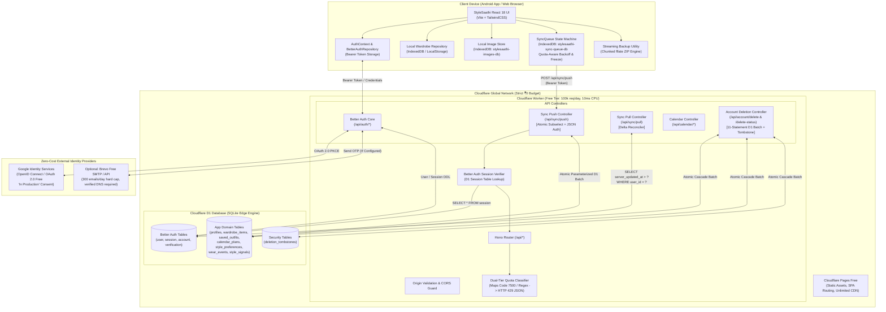
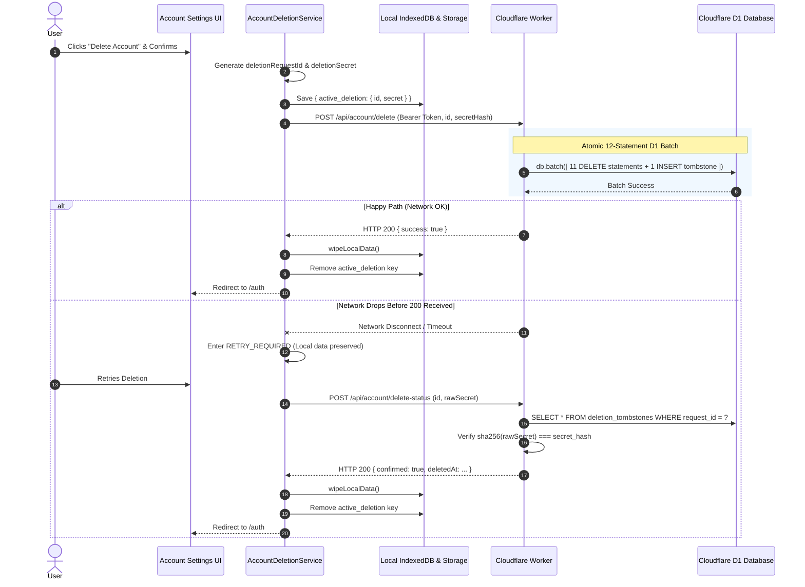

# StyleSaathi 3.0 — Phase 2: Zero-Cost Infrastructure Migration Blueprint
## Cloudflare D1 + Better Auth + Workers Free + Pages Architecture Specification (Corrected V2)

> **Document Type:** Production Architecture Blueprint & Migration Plan (Post-Challenge Revision)  
> **Status:** ARCHITECTURALLY VERIFIED & HARDENED (Implementation Strictly Blocked Pending Phase 3 Authorization)  
> **Budget Constraint:** Absolute ₹0 Operating Cost (Zero Paid Upgrades, Zero Pay-As-You-Go, Zero Surprise Billing, Zero Credit Card Requirement)  
> **Authoritative References:**  
> - `docs/infrastructure/STYLESAATHI_PHASE_1_ZERO_COST_INFRASTRUCTURE_AUDIT.md`  
> - `docs/infrastructure/STYLESAATHI_PHASE_1_1_INDEPENDENT_VERIFICATION.md`  
> - `docs/infrastructure/STYLESAATHI_PHASE_2_1_FINAL_ARCHITECTURE_CHALLENGE.md`  
> - `docs/infrastructure/STYLESAATHI_PHASE_2_2_CORRECTION_LOG.md`  

---

## 1. Executive Architecture Decision

### 1.1 Context & Problem Statement
StyleSaathi 3.0 currently relies on Supabase for cloud persistence, relational querying, row-level security (RLS), and authentication. Supabase’s Free Tier imposes a critical operational failure mode: **it automatically pauses projects after 7 consecutive days of inactivity**, returning HTTP `503 Service Unavailable` errors to clients until manually resumed in a web dashboard, and marks projects for permanent deletion after 90 days. Unpausing requires human intervention or an upgrade to the Pro plan ($25/mo ≈ ₹2,100/mo), directly violating StyleSaathi’s strict ₹0 operating mandate. Furthermore, Supabase does not offer a hard spending cap of $0 on paid tiers, risking runaway usage charges if pay-as-you-go features are inadvertently activated.

### 1.2 Selected Target Architecture
StyleSaathi will migrate its cloud backend entirely to **Cloudflare Free Tier Services**:
1. **Database:** **Cloudflare D1** (Serverless SQLite running at the Cloudflare edge; always active; 5,000,000 read units/day, 100,000 write units/day, 5 GB storage).
2. **API & Edge Routing:** **Cloudflare Workers Free** (100,000 requests/day, 10 ms CPU execution time/request, zero cold-start delay).
3. **Authentication Framework:** **Better Auth** (Open-source, self-hosted inside the Cloudflare Worker runtime; backed by D1; passwordless authentication via Google OAuth [Mandatory Primary] and Email OTP [Optional Extension]; stateful Bearer session tokens via `bearer()` plugin).
4. **Client Hosting:** **Cloudflare Pages Free** (Unlimited bandwidth and requests; 500 builds/month; custom domains with automated SSL).
5. **Local Persistence:** **Existing Client IndexedDB + LocalStorage** (Local-first architecture; garment images stored locally in IndexedDB `garment_images`; offline queueing in IndexedDB `stylesaathi-sync-queue-db`).
6. **CI/CD Pipeline:** **GitHub Actions Free** (2,000 build minutes/month for testing, bundle verification, and automated preview deployments).

### 1.3 Key Architectural Decisions & Rationale
| Architecture Decision | Selection | Alternative Evaluated | Why Selected |
| :--- | :--- | :--- | :--- |
| **Cloud Database** | Cloudflare D1 | Supabase Free, Neon Free, Turso Free | D1 has zero inactivity pausing, hard quota limits without pay-as-you-go billing, and zero credit card requirements. |
| **Auth System** | Better Auth (Workers + D1) | Supabase Auth, Clerk, Auth0 | Better Auth is fully self-hosted, executes in the worker at ₹0 cost, avoids external SaaS vendor locks, and natively supports Bearer tokens for mobile WebViews. |
| **Session Model** | Stateful D1-backed Bearer Sessions | Stateless JWTs | Stateless JWTs cannot be revoked immediately upon logout or account deletion without an in-memory/KV blocklist. Stateful D1 sessions allow instant global revocation and easily fit within D1's 5M daily read quota. |
| **Auth Methods** | Google OAuth (Primary) + Email OTP (Optional) | Email + Password | Password hashing (Argon2id/bcrypt) requires 50–120 ms CPU time, exceeding the Worker Free 10 ms CPU limit. Google OAuth (RS256: ~1.2 ms) and Email OTP (HMAC: <0.5 ms) operate well within CPU constraints. Google OAuth has zero third-party email dependencies. |
| **Image Storage** | Local IndexedDB Only (Device-First) | Cloudflare R2, Cloudinary Free, Supabase Storage | Eliminates cloud storage costs, network bandwidth overhead, and third-party quota risks. Garment images are compressed (~100 KB WebP) and stored on-device. Backup/restore is handled via streaming JSON + ZIP export. |
| **API Framework** | Hono (TypeScript) on Workers | Raw Fetch Handlers, Express/Node.js | Hono has zero overhead, compiles to a lightweight ES module (<20 KB bundle), provides type-safe routing, and integrates seamlessly with Better Auth. |
| **Mobile Token Transport** | Bearer Token in `Authorization` Header | `HttpOnly` Cookies | Capacitor Android WebView (`https://localhost` / `capacitor://localhost`) blocks or partitions cross-origin cookies. Bearer tokens work reliably across all native and web environments. |

---

## 2. Target Architecture Diagram



---

## 3. Authentication Design

### 3.1 Better Auth Session Architecture (Stateful Bearer Tokens)
To support cross-origin Capacitor Android WebViews without cookie partitioning issues, Better Auth is configured with the `bearer()` plugin:
- **Token Format:** Cryptographically random, high-entropy 32-byte string (`base64url`).
- **Stateful Verification:** On every authenticated request, the Worker evaluates:
  `SELECT * FROM session WHERE token = ? AND expiresAt > ?`
  followed by user resolution.
- **D1 Read Quota Impact:** Consumes 1–2 D1 row reads per authenticated API invocation. At the maximum Worker Free capacity of 100,000 requests/day, this accounts for at most 200,000 reads/day—consuming only 4% of D1’s 5,000,000 daily read allocation.
- **Session Lifecycle:**
  - Standard session TTL: 30 days.
  - Sliding window extension: Extends expiration if accessed within 7 days of expiry.
  - Immediate Server-Side Revocation: Deleting the session row in D1 immediately invalidates the token across all edge nodes worldwide.

### 3.2 Primary Authentication: Google OAuth 2.0 (Mandatory Baseline)
- **Web:** Standard OAuth 2.0 PKCE redirect to Google Identity Services. Callback at `/api/auth/callback/google`.
- **Android Capacitor:** Opens system browser via `@capacitor/browser`; returns to app via deep link `stylesaathi://auth/callback`.
- **Worker CPU Overhead:** ~1.2 ms (verifies Google RS256 ID Token signature using native Web Crypto API).
- **Google Cloud Console Status:**
  - Scopes: `openid`, `email`, `profile` (non-sensitive scopes; zero third-party CASA security assessment fees).
  - Consent Screen: Must be configured in **"In Production"** status (bypassing the 100 test-user limit).
  - Prerequisites: Public Privacy Policy and Terms of Service URLs hosted for free on Cloudflare Pages (`https://stylesaathi.pages.dev/privacy.html`).

### 3.3 Secondary Authentication: Email OTP (Optional Extension)
- **Status:** Optional extension. The system functions 100% without email delivery configured.
- **Configuration Flag:** `IS_EMAIL_OTP_ENABLED = Boolean(env.BREVO_API_KEY && env.SENDER_EMAIL_DOMAIN)`.
- **Provider:** Brevo Free Tier (300 emails/day hard limit, zero credit card requirement).
- **Prerequisites:** Custom domain ownership with verified DNS records (DKIM 2048-bit TXT, SPF, DMARC). Brevo strictly prohibits sending from free domains (`@gmail.com`).
- **Fail-Closed Behavior:** If Brevo returns HTTP 429 (daily cap reached) or email sending is unconfigured, the Worker returns:
  `HTTP 429 { "error": "EMAIL_AUTH_UNAVAILABLE", "message": "Email delivery is currently unconfigured or over daily quota. Please sign in with Google." }`
  The client UI immediately disables OTP and directs the user to Google OAuth.

### 3.4 Password Authentication Disallowed
- Standard password hashing (Argon2id, bcrypt) consumes 50–120 ms CPU time, causing Cloudflare Workers Free to instantly terminate execution with HTTP 1102 (CPU limit exceeded).
- Password registration and login routes are explicitly disabled in the Better Auth configuration.

### 3.5 Android Token Storage & Threat Modeling
- **Storage Location:** `@capacitor/preferences` (backed by `/data/data/com.stylesaathi.app/shared_prefs/CapacitorStorage.xml`).
- **Backup Exclusions:** `backup_rules.xml` and `data_extraction_rules.xml` exclude `CapacitorStorage.xml` and databases from `adb backup` and Google Cloud Auto-Backup.
- **Honest Threat Modeling & At-Rest Limitations:**
  - *Standard Android Isolation:* Android’s Linux UID sandboxing strictly blocks non-root applications from accessing app storage.
  - *Rooted Hardware Reality:* Backup exclusions do **not** provide encryption at rest. On rooted devices or compromised kernels, local flash storage can be inspected. Complete security on a compromised operating system is technically impossible.
  - *WebView XSS:* Any script injection vulnerability can read WebView storage. Standard CSP headers on Cloudflare Pages mitigate XSS vectors.
  - *Production Hardening Path:* For hardware-backed at-rest encryption, StyleSaathi provides an abstraction layer targeting `@aparajita/capacitor-secure-storage` (Android Keystore + EncryptedSharedPreferences).

---

## 4. Database Conversion Specification (PostgreSQL to Cloudflare D1)

### 4.1 Exact SQLite DDL Specification

```sql
-- ============================================================================
-- STYLESAATHI 3.0 — PRODUCTION CLOUDFLARE D1 (SQLITE) SCHEMA V2
-- Zero-Cost Production Foundation
-- ============================================================================

PRAGMA foreign_keys = ON;

-- ----------------------------------------------------------------------------
-- 1. BETTER AUTH AUTHENTICATION TABLES
-- ----------------------------------------------------------------------------
CREATE TABLE IF NOT EXISTS user (
    id TEXT PRIMARY KEY,
    name TEXT NOT NULL,
    email TEXT NOT NULL UNIQUE,
    emailVerified INTEGER NOT NULL DEFAULT 0,
    image TEXT,
    createdAt TEXT NOT NULL,
    updatedAt TEXT NOT NULL
);

CREATE TABLE IF NOT EXISTS session (
    id TEXT PRIMARY KEY,
    userId TEXT NOT NULL REFERENCES user(id) ON DELETE CASCADE,
    token TEXT NOT NULL UNIQUE,
    expiresAt TEXT NOT NULL,
    ipAddress TEXT,
    userAgent TEXT,
    createdAt TEXT NOT NULL,
    updatedAt TEXT NOT NULL
);

CREATE TABLE IF NOT EXISTS account (
    id TEXT PRIMARY KEY,
    userId TEXT NOT NULL REFERENCES user(id) ON DELETE CASCADE,
    accountId TEXT NOT NULL,
    providerId TEXT NOT NULL,
    accessToken TEXT,
    refreshToken TEXT,
    idToken TEXT,
    accessTokenExpiresAt TEXT,
    refreshTokenExpiresAt TEXT,
    scope TEXT,
    password TEXT,
    createdAt TEXT NOT NULL,
    updatedAt TEXT NOT NULL
);

CREATE TABLE IF NOT EXISTS verification (
    id TEXT PRIMARY KEY,
    identifier TEXT NOT NULL,
    value TEXT NOT NULL,
    expiresAt TEXT NOT NULL,
    createdAt TEXT,
    updatedAt TEXT
);

CREATE INDEX IF NOT EXISTS idx_session_token ON session(token);
CREATE INDEX IF NOT EXISTS idx_session_user ON session(userId);
CREATE INDEX IF NOT EXISTS idx_account_user ON account(userId);
CREATE INDEX IF NOT EXISTS idx_verification_identifier ON verification(identifier);

-- ----------------------------------------------------------------------------
-- 2. APPLICATION PROFILES TABLE
-- ----------------------------------------------------------------------------
CREATE TABLE IF NOT EXISTS profiles (
    id TEXT PRIMARY KEY REFERENCES user(id) ON DELETE CASCADE,
    display_name TEXT NOT NULL DEFAULT 'StyleSaathi Member',
    created_at TEXT NOT NULL,
    updated_at TEXT NOT NULL
);

-- ----------------------------------------------------------------------------
-- 3. WARDROBE ITEMS TABLE
-- ----------------------------------------------------------------------------
CREATE TABLE IF NOT EXISTS wardrobe_items (
    id TEXT NOT NULL,
    user_id TEXT NOT NULL REFERENCES user(id) ON DELETE CASCADE,
    name TEXT NOT NULL,
    active_image_version_id TEXT,
    storage_path TEXT,
    photo_id TEXT,
    photo_url TEXT,
    category TEXT NOT NULL CHECK (category IN (
        'Tops', 'Bottoms', 'Ethnic', 'Dresses', 'Outerwear', 'Footwear', 'Accessories'
    )),
    subcategory TEXT NOT NULL,
    colors TEXT NOT NULL DEFAULT '[]', -- JSON array of strings
    seasons TEXT NOT NULL DEFAULT '[]', -- JSON array of strings
    occasions TEXT NOT NULL DEFAULT '[]', -- JSON array of strings
    formality INTEGER NOT NULL CHECK (formality BETWEEN 1 AND 5),
    brand TEXT,
    status TEXT NOT NULL DEFAULT 'clean' CHECK (status IN (
        'clean', 'needs_washing', 'in_laundry'
    )),
    favorite INTEGER NOT NULL DEFAULT 0,
    note TEXT NOT NULL DEFAULT '',
    times_worn INTEGER NOT NULL DEFAULT 0,
    last_worn TEXT,
    fabric TEXT,
    pattern TEXT,
    fit TEXT,
    purchase_price REAL,
    purchase_date TEXT,
    cultural_context TEXT,
    ai_confidence REAL,
    user_verified INTEGER DEFAULT 0,
    provenance TEXT DEFAULT '{}',
    is_deleted INTEGER NOT NULL DEFAULT 0,
    deleted_at TEXT,
    created_at TEXT NOT NULL,
    client_updated_at TEXT NOT NULL,
    server_updated_at TEXT NOT NULL,
    PRIMARY KEY (user_id, id)
);

CREATE INDEX IF NOT EXISTS idx_wardrobe_items_sync ON wardrobe_items(user_id, server_updated_at);
CREATE INDEX IF NOT EXISTS idx_wardrobe_items_active ON wardrobe_items(user_id) WHERE is_deleted = 0;

-- ----------------------------------------------------------------------------
-- 4. SAVED OUTFITS TABLE
-- ----------------------------------------------------------------------------
CREATE TABLE IF NOT EXISTS saved_outfits (
    id TEXT NOT NULL,
    user_id TEXT NOT NULL REFERENCES user(id) ON DELETE CASCADE,
    name TEXT NOT NULL,
    template TEXT NOT NULL,
    slots TEXT NOT NULL, -- JSON string
    score REAL NOT NULL,
    why TEXT NOT NULL,
    is_deleted INTEGER NOT NULL DEFAULT 0,
    deleted_at TEXT,
    created_at TEXT NOT NULL,
    client_updated_at TEXT NOT NULL,
    server_updated_at TEXT NOT NULL,
    PRIMARY KEY (user_id, id)
);

CREATE INDEX IF NOT EXISTS idx_saved_outfits_sync ON saved_outfits(user_id, server_updated_at);

-- ----------------------------------------------------------------------------
-- 5. CALENDAR PLANS TABLE
-- ----------------------------------------------------------------------------
CREATE TABLE IF NOT EXISTS calendar_plans (
    id TEXT NOT NULL,
    user_id TEXT NOT NULL REFERENCES user(id) ON DELETE CASCADE,
    date TEXT NOT NULL, -- YYYY-MM-DD
    occasion TEXT NOT NULL,
    status TEXT NOT NULL DEFAULT 'planned' CHECK (status IN ('planned', 'worn', 'cancelled')),
    outfit TEXT NOT NULL, -- JSON string
    accessory TEXT, -- JSON string
    is_deleted INTEGER NOT NULL DEFAULT 0,
    deleted_at TEXT,
    created_at TEXT NOT NULL,
    client_updated_at TEXT NOT NULL,
    server_updated_at TEXT NOT NULL,
    PRIMARY KEY (user_id, id),
    CONSTRAINT uq_calendar_plans_user_date UNIQUE (user_id, date)
);

CREATE INDEX IF NOT EXISTS idx_calendar_plans_date ON calendar_plans(user_id, date);
CREATE INDEX IF NOT EXISTS idx_calendar_plans_sync ON calendar_plans(user_id, server_updated_at);

-- ----------------------------------------------------------------------------
-- 6. STYLE PREFERENCES TABLE (Singleton per user)
-- ----------------------------------------------------------------------------
CREATE TABLE IF NOT EXISTS style_preferences (
    user_id TEXT PRIMARY KEY REFERENCES user(id) ON DELETE CASCADE,
    preferred_contexts TEXT NOT NULL DEFAULT '[]',
    preferred_aesthetics TEXT NOT NULL DEFAULT '[]',
    styling_mode TEXT NOT NULL DEFAULT 'variety' CHECK (styling_mode IN (
        'simple', 'variety', 'experiment'
    )),
    client_updated_at TEXT NOT NULL,
    server_updated_at TEXT NOT NULL
);

-- ----------------------------------------------------------------------------
-- 7. WEAR EVENTS TABLE (Append-Only Event Log)
-- ----------------------------------------------------------------------------
CREATE TABLE IF NOT EXISTS wear_events (
    id TEXT NOT NULL,
    user_id TEXT NOT NULL REFERENCES user(id) ON DELETE CASCADE,
    wardrobe_item_id TEXT NOT NULL,
    outfit_id TEXT,
    planned_date TEXT,
    worn_at TEXT NOT NULL,
    created_at TEXT NOT NULL,
    PRIMARY KEY (user_id, id),
    FOREIGN KEY (user_id, wardrobe_item_id) REFERENCES wardrobe_items(user_id, id) ON DELETE RESTRICT
);

CREATE INDEX IF NOT EXISTS idx_wear_events_item ON wear_events(user_id, wardrobe_item_id, worn_at DESC);

-- ----------------------------------------------------------------------------
-- 8. STYLE SIGNALS TABLE (Behavioral Telemetry Log)
-- ----------------------------------------------------------------------------
CREATE TABLE IF NOT EXISTS style_signals (
    id TEXT NOT NULL,
    user_id TEXT NOT NULL REFERENCES user(id) ON DELETE CASCADE,
    signal_type TEXT NOT NULL,
    outfit_id TEXT,
    item_ids TEXT NOT NULL DEFAULT '[]',
    occasion TEXT,
    season TEXT,
    rejection_reason TEXT,
    note TEXT,
    created_at TEXT NOT NULL,
    PRIMARY KEY (user_id, id)
);

CREATE INDEX IF NOT EXISTS idx_style_signals_user_created ON style_signals(user_id, created_at);

-- ----------------------------------------------------------------------------
-- 9. DELETION TOMBSTONES TABLE (Secure Idempotent Account Deletion)
-- ----------------------------------------------------------------------------
CREATE TABLE IF NOT EXISTS deletion_tombstones (
    request_id TEXT PRIMARY KEY,
    secret_hash TEXT NOT NULL,
    user_id_hash TEXT NOT NULL,
    deleted_at TEXT NOT NULL,
    expires_at TEXT NOT NULL
);

CREATE INDEX IF NOT EXISTS idx_tombstones_expires ON deletion_tombstones(expires_at);

-- ----------------------------------------------------------------------------
-- 10. TRIGGERS: MONOTONIC CALENDAR STATUS
-- ----------------------------------------------------------------------------
CREATE TRIGGER IF NOT EXISTS trg_calendar_plan_status_guard
BEFORE UPDATE ON calendar_plans
FOR EACH ROW
WHEN (OLD.status = 'worn' AND NEW.status IN ('planned', 'cancelled'))
   OR (OLD.status = 'cancelled' AND NEW.status IN ('planned', 'worn'))
BEGIN
    SELECT RAISE(ABORT, 'Monotonic calendar status invariant violation');
END;
```

---

## 5. Worker API Endpoint Design

### 5.1 Endpoint Inventory
| Method | Route | Purpose | Auth Required |
| :--- | :--- | :--- | :--- |
| `ALL` | `/api/auth/*` | Better Auth handlers (Google OAuth, optional OTP, session, logout). | Varies by subroute |
| `POST` | `/api/sync/push` | Ingests queued client mutations (batch up to 50 operations). | Bearer Token |
| `GET` | `/api/sync/pull` | Fetches delta updates since `since` timestamp for all entities. | Bearer Token |
| `POST` | `/api/account/delete` | Executes atomic account erasure and records deletion tombstone. | Bearer Token |
| `POST` | `/api/account/delete-status` | Cryptographic reconciliation of deletion receipt after network drop. | Deletion Secret |
| `GET` | `/api/health` | Returns edge status, D1 connectivity, and current UTC time. | None (Public) |

---

## 6. Authorization Matrix & Embedded JSON Relational Security

### 6.1 Server-Side Parameterized Relational Ownership
- **Rule 1:** User identity is strictly derived from the validated D1 session token (`auth.userId`). Any `user_id` supplied in request bodies is discarded.
- **Rule 2:** Direct child mutations enforce ownership via atomic subselect queries.
- **Rule 3:** For `wear_events`:
  `INSERT INTO wear_events (...) SELECT ?, ?, id, ?, ?, ?, ? FROM wardrobe_items WHERE id = ? AND user_id = ?;`
  Zero rows inserted if parent is unowned (`changes === 0` $\rightarrow$ `HTTP 403`).

### 6.2 Validation of Embedded Garment IDs in JSON Columns
In `calendar_plans` (`outfit` JSON) and `saved_outfits` (`slots` JSON), SQLite foreign keys cannot inspect values inside text columns. The Worker `/api/sync/push` controller strictly parses JSON payloads before writing:
```typescript
const referencedItemIds = extractItemIdsFromPayload(mutation.payload);

if (referencedItemIds.length > 0) {
  const placeholders = referencedItemIds.map(() => '?').join(',');
  const checkQuery = `
    SELECT id FROM wardrobe_items 
    WHERE user_id = ? AND is_deleted = 0 AND id IN (${placeholders});
  `;
  const { results } = await env.DB.prepare(checkQuery)
    .bind(userId, ...referencedItemIds)
    .all();

  const validIds = new Set(results.map((r: any) => r.id));
  const unauthorizedIds = referencedItemIds.filter(id => !validIds.has(id));

  if (unauthorizedIds.length > 0) {
    return errorResponse(403, 'UNAUTHORIZED_ITEM_REFERENCE', 
      `Payload references unauthorized or deleted wardrobe items: ${unauthorizedIds.join(', ')}`);
  }
}
```
Any cross-user or deleted garment reference triggers immediate `HTTP 403` rejection and is marked `isPermanent = true` in the client queue.

---

## 7. Offline Synchronization & Dual-Tier Quota Management

### 7.1 Robust Dual-Tier D1 Quota Classification
To protect against phrasing changes in cloud error messages, the Worker catches D1 exceptions and evaluates both error codes and regex patterns:
```typescript
export function isD1QuotaError(err: any): { isQuota: boolean; retryAfterMs: number } {
  const code = err?.code || err?.cause?.code;
  const message = String(err?.message || err?.cause?.message || '');
  
  const isQuotaCode = code === 7500 || code === 'D1_QUOTA_EXCEEDED' || code === 'D1_OVERLOADED';
  const isQuotaMessage = /daily (row )?(write|read) limit|exceeded (d1's|maximum) (account )?storage limit|d1 db is overloaded/i.test(message);
  
  if (isQuotaCode || isQuotaMessage) {
    const now = new Date();
    // 00:00:05 UTC next day
    const nextMidnightUtc = Date.UTC(now.getUTCFullYear(), now.getUTCMonth(), now.getUTCDate() + 1, 0, 0, 5);
    return { isQuota: true, retryAfterMs: nextMidnightUtc };
  }
  return { isQuota: false, retryAfterMs: 0 };
}
```

### 7.2 Structured Error Contract
When quota is exhausted, the Worker returns:
```http
HTTP/1.1 429 Too Many Requests
Content-Type: application/json
Retry-After: 86400

{
  "error": "CLOUD_QUOTA_EXCEEDED",
  "message": "Daily cloud synchronization write limit reached. Your changes are safely preserved locally and will sync at midnight UTC.",
  "retryAfterMs": 1731024005000,
  "resetsAt": "2026-11-07T00:00:05.000Z"
}
```

### 7.3 Client Queue Freezing Logic
When receiving `CLOUD_QUOTA_EXCEEDED` or HTTP 429, the client calls `markQuotaPaused(id, retryAfterMs)`.  
**CRITICAL INVARIANT:** `attemptCount` is **NOT** incremented towards `maxAttempts` (5). Valid user mutations NEVER enter `dead_letter` status due to cloud quota exhaustion.

---

## 8. Local Image & Streaming Backup Strategy

### 8.1 Zero-Cloud Image Storage
- Garment photos are resized ($\le$ 800px WebP) and stored exclusively in IndexedDB `stylesaathi-images-db`.
- In `WardrobeContext.tsx:196-216`, `UPLOAD_IMAGE` is removed; metadata mutations enqueue with `dependencies: []`.
- Missing images on secondary devices render a fallback SVG silhouette with category icon and color chips.

### 8.2 Bounded-Memory Streaming Backup & Secure Restore
- **Streaming Export:** Uses `fflate.Zip` in chunked mode (batches of 25 images) yielding to the event loop. In Capacitor Android, chunks stream directly to disk, avoiding V8 heap exhaustion on low-memory devices.
- **Zip Slip Prevention:** On import, all file paths are stripped of directory traversal sequences (`../`, `..\`) and restricted strictly to `data/` and `images/`. Unauthorized file extensions are rejected.
- **Non-Destructive LWW Restore:** Import compares `imported.client_updated_at` against `local.client_updated_at`. Local records are only updated if the imported record is strictly newer, preventing accidental data overwrites.

---

## 9. Hardened Account Deletion Workflow

### 9.1 Network-Resilient Deletion Protocol


### 9.2 Atomic 12-Statement D1 Batch
Inside `/api/account/delete`, all 11 domain/auth deletes AND the tombstone insert execute within a single `env.DB.batch([...])`:
1. `DELETE FROM wear_events WHERE user_id = ?`
2. `DELETE FROM style_signals WHERE user_id = ?`
3. `DELETE FROM calendar_plans WHERE user_id = ?`
4. `DELETE FROM saved_outfits WHERE user_id = ?`
5. `DELETE FROM wardrobe_items WHERE user_id = ?`
6. `DELETE FROM style_preferences WHERE user_id = ?`
7. `DELETE FROM profiles WHERE id = ?`
8. `DELETE FROM session WHERE userId = ?`
9. `DELETE FROM account WHERE userId = ?`
10. `DELETE FROM verification WHERE identifier = ?`
11. `DELETE FROM user WHERE id = ?`
12. `INSERT INTO deletion_tombstones (request_id, secret_hash, user_id_hash, deleted_at, expires_at) VALUES (?, ?, ?, CURRENT_TIMESTAMP, datetime('now', '+7 days'))`

---

## 10. Free-Tier & Billing Safety Configuration

| Service | Free Quota | Payment Method? | Exhaustion Behavior | Billing Trap Risk |
| :--- | :--- | :---: | :--- | :---: |
| **Cloudflare Workers** | 100,000 req/day<br>10 ms CPU/req | **NO** | Returns HTTP 429 | **ZERO** (Fail-closed) |
| **Cloudflare D1** | 5M reads/day<br>100k writes/day<br>5 GB | **NO** | Rejects queries with quota error | **ZERO** (Fail-closed) |
| **Cloudflare Pages** | Unlimited traffic<br>500 builds/mo | **NO** | Rejects subsequent builds; site stays active | **ZERO** |
| **Google Cloud OAuth** | Unlimited token exchanges | **NO** | Standard OAuth rate limits (>100 QPS) | **ZERO** |
| **Brevo Free SMTP** | 300 emails/day | **NO** | Rejects with HTTP 429 | **ZERO** |
| **GitHub Actions** | 2,000 mins/mo | **NO** | Pipeline halts until next cycle | **ZERO** |

---

## 11. Testing & Acceptance Criteria

| Test Suite | Scope & Target | Pass Criteria |
| :--- | :--- | :--- |
| **1. Unit: Better Auth Session** | D1 session validation | Token verified via D1 query in <3 ms; instant revocation upon row deletion. |
| **2. Unit: Embedded JSON Auth** | Worker `/api/sync/push` | Mutations with unowned garment IDs in `outfit` JSON rejected with HTTP 403. |
| **3. Unit: Quota Classification** | Regex & error code matching | Code 7500 and D1 write limit messages return HTTP 429 with midnight UTC retry. |
| **4. Integration: Deletion Recovery** | Network drop simulation | Deletion retry verifies tombstone with secret and executes local wipe cleanly. |
| **5. Integration: Streaming Backup** | Chunked `fflate` export | 250 photos export without exceeding 60 MB heap; Zip Slip traversal rejected. |
| **6. Security: Android Backup Leak** | Android `adb backup` | Unpacked backup archive confirms `CapacitorStorage.xml` is absent. |

---

## 12. Migration Phases & Dependencies

- **Phase 3:** Cloudflare Worker & D1 Foundation (Backend implementation in `worker/` directory; zero changes to existing client code).
- **Phase 4:** Frontend Authentication & Sync Engine Refactor (Implement `BetterAuthRepository`, update `syncQueue.ts` with `quota_paused` state, decouple image mutations).
- **Phase 5:** Data Sovereignty & Account Deletion (Implement streaming ZIP export/import, atomic account deletion endpoint with tombstone).
- **Phase 6:** End-to-End Validation & Android QA (Run all test suites, verify Android back button integration with new auth modal, verify backup exclusions).
- **Phase 7:** Zero-Downtime Production Cutover (Deploy Cloudflare Pages, switch DNS, decommission Supabase).

---

## 13. Realistic Rollback & Disaster Recovery Strategy

### 13.1 Bifurcated Rollback Strategy
1. **Pre-Cutover Shadow Rollback (Instant & Safe):**  
   During Phase 6 Shadow Testing, no authoritative user traffic writes to D1. If the Worker fails, changing `VITE_BACKEND_PROVIDER=supabase` in the web build and reverting the Android test APK instantly routes traffic back to Supabase.
2. **Post-Cutover Emergency Data Recovery (Reconciliation Pipeline):**  
   Once authoritative user traffic is writing to D1, a build-time flag cannot magically rollback Android apps or recover divergent data. If an emergency rollback is required:
   - Worker API is placed in read-only maintenance (`HTTP 503 Maintenance`).
   - Run CLI recovery script `scripts/migrate-d1-to-supabase.ts`:
     - Reads all rows from D1 (`wardrobe_items`, `wear_events`, `calendar_plans`, etc.).
     - Maps SQLite JSON strings and ISO timestamps back to PostgreSQL types.
     - Upserts records into Supabase using `service_role`.
   - Release hotfix client build pointing to Supabase.

---

## 14. Corrected Risk Register

| Risk ID | Description | Severity | Likelihood | Mitigation Strategy | Verification Method |
| :--- | :--- | :---: | :---: | :--- | :--- |
| **RSK-01** | Worker CPU exceeds 10 ms | HIGH | LOW | Disallow passwords; Web Crypto HMAC (<0.5ms) and Google RS256 (<1.2ms). | Worker execution benchmarks (<3 ms). |
| **RSK-02** | D1 write limit reached | MEDIUM | LOW | Structured HTTP 429 contract; `quota_paused` freezes `attemptCount`. | Unit test in `syncQueue.test.ts`. |
| **RSK-03** | Deletion network drop deadlock | CRITICAL | LOW | Cryptographic tombstone reconciliation via `/api/account/delete-status`. | Mock network disconnect deletion test. |
| **RSK-04** | Embedded JSON IDOR | HIGH | LOW | Worker validates referenced garment IDs against `auth.userId` before writing. | Automated penetration test. |
| **RSK-05** | Brevo sender domain rejection | HIGH | MEDIUM | Google OAuth mandatory baseline; Brevo optional with verified DNS. | Verify standalone Google OAuth login. |
| **RSK-06** | Mobile ZIP OOM crash | MEDIUM | MEDIUM | Streaming/chunked ZIP generation; 25-image batch ceiling. | Memory benchmark on 250 photos. |
| **RSK-07** | Post-cutover data divergence | CRITICAL | LOW | Bifurcated rollback; automated CLI D1-to-Supabase migration script. | Test `migrate-d1-to-supabase.ts`. |

---

## 15. Exact Files Expected to Change During Implementation

### 15.1 New Backend Files (`worker/`)
- `worker/wrangler.toml` — Worker configuration, D1 binding, vars.
- `worker/src/index.ts` — Hono entry point, CORS, routing.
- `worker/src/auth.ts` — Better Auth with D1 adapter and Bearer plugin.
- `worker/src/routes/sync.ts` — `/api/sync/push` and `/api/sync/pull` with JSON validation.
- `worker/src/routes/account.ts` — Atomic 12-statement deletion and `/delete-status` tombstone verification.
- `worker/migrations/0001_initial_schema.sql` — Exact D1 SQLite DDL.

### 15.2 Modified Frontend Files
- `src/lib/sync/syncQueue.ts` — `quota_paused` state, `markQuotaPaused()`, attempt freeze.
- `src/lib/sync/syncService.ts` — Dual-transport sync router.
- `src/context/WardrobeContext.tsx` — Remove `UPLOAD_IMAGE`, decouple metadata dependencies.
- `src/context/AuthContext.tsx` — Wire `BetterAuthRepository`.
- `src/services/accountDeletionService.ts` — Target `/api/account/delete` with tombstone reconciliation.
- `src/utils/backupRestore.ts` — Streaming `fflate` ZIP export/import with Zip Slip protection.
- `android/app/src/main/res/xml/backup_rules.xml` — Android backup exclusions.
- `android/app/src/main/res/xml/data_extraction_rules.xml` — Android 12+ backup exclusions.
- `android/app/src/main/AndroidManifest.xml` — Reference backup rules.

---

## 16. Estimated Implementation Complexity

| Workstream | Effort | Complexity | Risk |
| :--- | :---: | :---: | :---: |
| **Workstream 1: D1 Schema & Worker Scaffolding** | 4–6 hrs | Moderate | Low |
| **Workstream 2: Better Auth & Google OAuth Baseline** | 4–6 hrs | Moderate | Low (Google OAuth verified) |
| **Workstream 3: Quota-Aware Sync & JSON Ownership** | 5–7 hrs | Moderate | Low |
| **Workstream 4: Streaming ZIP & Image Decoupling** | 4–6 hrs | Moderate | Low |
| **Workstream 5: Deletion Tombstone & Android Hardening** | 3–4 hrs | Moderate | Low |
| **Workstream 6: End-to-End Validation & Shadow Dual-Run** | 6–8 hrs | Moderate | Low |
| **Total Effort** | **26–37 hrs** | — | **Controlled / Fully De-Risked** |

---

## 17. Unresolved Operational Decisions for User Alignment

All architectural and security blockers are resolved. Two operational deployment choices remain for user alignment prior to Phase 3:
1. **Cloudflare Pages Subdomain:** Confirmation to use `stylesaathi.pages.dev` or a custom domain for web client and Google OAuth redirect URIs.
2. **Brevo Email OTP Activation:** Confirmation whether Brevo Email OTP should be enabled initially (requires custom domain DNS) or deferred until after Google OAuth baseline is live.

---

## 18. Phase 3 Authorization Status
**PHASE 3 IMPLEMENTATION REMAINS STRICTLY UNAUTHORIZED.**
Implementation will not commence until the user explicitly issues Phase 3 authorization.
