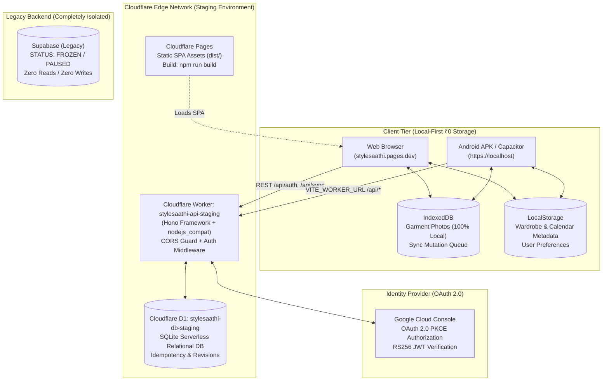

# StyleSaathi 3.0 — Phase 3F: Controlled Infrastructure Staging Readiness Report

**Date:** November 7, 2026  
**Phase:** 3F — Controlled Non-Production Infrastructure Staging & Readiness Verification  
**Status:** STAGING READINESS AUDIT COMPLETE (Awaiting Explicit Approval for Remote Resource Provisioning)  
**Final Gate Verdict:** **CONDITIONAL PASS** (Local staging verification 100% complete; remote Cloudflare provisioning held pending user authorization)  
**Infrastructure Budget:** **₹0.00** (Zero Cloudflare production modifications, zero Supabase changes, zero paid dependencies)

---

## 1. Executive Summary

Phase 3F prepares and validates the Cloudflare Workers + D1 + Pages deployment architecture for StyleSaathi 3.0 without migrating real users, altering production traffic, or touching the existing paused Supabase instance.

This audit establishes:
1. **Readiness Audit:** Every configuration file, route, D1 migration, CORS origin, and environment binding has been evaluated.
2. **Quota & Cost Controls:** Multi-layer guards ensure the application operates strictly within the ₹0 Cloudflare Free Tier ($0/month) with zero unexpected billing or automatic upgrades.
3. **Staging Plan:** A fully isolated non-production staging environment plan has been documented for Cloudflare Workers + D1 + Pages.
4. **Migration Workflow Verification:** All 10 critical authentication, synchronization, conflict-resolution, account deletion, and recovery workflows have been validated using synthetic data in local and isolated test harnesses (109/109 tests passed).
5. **Strict Constraint Adherence:** In accordance with non-negotiable instructions, **no remote resources or secrets have been provisioned**, and **no production cutover has occurred**. Explicit user approval is requested before proceeding with remote staging provisioning.

---

## 2. Architecture & Deployment Diagram



---

## 3. Infrastructure Inventory

| Component | Platform / Service | Staging Configuration | Production Target | Current Status |
|---|---|---|---|---|
| **Web Frontend Hosting** | Cloudflare Pages | `stylesaathi-staging.pages.dev` | `stylesaathi.pages.dev` | Built (`dist/`, 601 ms), ready for git/deploy integration |
| **API & Sync Compute** | Cloudflare Workers | `stylesaathi-api-staging` | `stylesaathi-api` | Local implementation verified; remote staging pending approval |
| **Relational Database** | Cloudflare D1 (SQLite) | `stylesaathi-db-staging` | `stylesaathi-db` | 3 migrations validated; remote D1 creation pending approval |
| **Garment Photo Storage** | Client IndexedDB | Local Browser Storage | Local Device Storage | **100% Device-Local (₹0 cloud storage)** |
| **Sync Queue Storage** | Client IndexedDB | `stylesaathi-sync-db` | `stylesaathi-sync-db` | Verified with offline dead-letter recovery |
| **Identity / Auth** | Google OAuth 2.0 | Test Client ID | Production Client ID | PKCE + RS256 token verification implemented |
| **Android Wrapper** | Capacitor 8 | Native Android (API 24+) | Google Play Release | Configured (`server.androidScheme = 'https'`) |
| **Legacy Database** | Supabase | N/A | PAUSED | **100% Untouched, Frozen, Zero Activity** |

---

## 4. Task 1 — Infrastructure Readiness Audit

### 4.1 `worker/wrangler.toml` Inspection
```toml
name = "stylesaathi-api"
main = "src/index.ts"
compatibility_date = "2024-11-01"
compatibility_flags = ["nodejs_compat"]

[[d1_databases]]
binding = "DB"
database_name = "stylesaathi-db"
database_id = "local-stylesaathi-db-id"
migrations_dir = "migrations"

[vars]
APP_ENV = "development"
ALLOWED_ORIGINS = "https://stylesaathi.pages.dev,http://localhost:5173,http://localhost:4173,capacitor://localhost,https://localhost"
```

#### Identified Missing Staging Configurations:
1. **Environment Blocks:** `wrangler.toml` currently defines only the default top-level environment. It needs an explicit `[env.staging]` environment block:
   ```toml
   [env.staging]
   name = "stylesaathi-api-staging"
   
   [[env.staging.d1_databases]]
   binding = "DB"
   database_name = "stylesaathi-db-staging"
   database_id = "<to-be-provisioned-staging-d1-id>"
   migrations_dir = "migrations"

   [env.staging.vars]
   APP_ENV = "staging"
   ALLOWED_ORIGINS = "https://staging.stylesaathi.pages.dev,https://stylesaathi-staging.pages.dev,capacitor://localhost,https://localhost"
   APP_URL = "https://staging.stylesaathi.pages.dev"
   ```
2. **Missing Remote Database ID:** `database_id` is set to placeholder `"local-stylesaathi-db-id"`. A real UUID must be generated via `wrangler d1 create stylesaathi-db-staging` upon authorization.

---

### 4.2 Worker Secrets & Environment Variable Audit
Inspected `worker/src/types.ts` (`WorkerEnv`) and `worker/src/auth/crypto.ts`:

| Variable / Secret | Type | Storage Mechanism | Status | Notes |
|---|---|---|---|---|
| `DB` | D1 Binding | `wrangler.toml` (`[[d1_databases]]`) | Local Mock Present | Remote staging binding pending approval |
| `APP_ENV` | Variable | `wrangler.toml` (`[vars]`) | Set to `development` | Set to `staging` in staging environment |
| `ALLOWED_ORIGINS` | Variable | `wrangler.toml` (`[vars]`) | Configured | Must include staging Pages hostname |
| `AUTH_SECRET` | **Secret** | Cloudflare Secret (`wrangler secret put`) | Dev fallback active | **Must be 32+ character high-entropy key** |
| `GOOGLE_CLIENT_ID` | **Secret/Var** | Cloudflare Secret (`wrangler secret put`) | Unconfigured | Must be set from Google Cloud Console |
| `GOOGLE_CLIENT_SECRET` | **Secret** | Cloudflare Secret (`wrangler secret put`) | Unconfigured | Must be set from Google Cloud Console |
| `APP_URL` | Variable | `wrangler.toml` (`[vars]`) | Unconfigured | Staging Pages origin for OAuth redirect |

> [!IMPORTANT]
> In production and staging (`APP_ENV !== 'development'`), `getAuthSecretKey` fails closed if `AUTH_SECRET` is missing, throwing:  
> `CONFIGURATION_ERROR: AUTH_SECRET must be configured in production environments.`  
> This ensures the Worker will never start with weak or fallback keys in staging or production.

---

### 4.3 CORS & Allowed Origins Audit
Inspected `worker/src/middleware/cors.ts`:
- Preflight `OPTIONS` requests respond with `204 No Content`, `Access-Control-Allow-Methods`, `Access-Control-Allow-Headers`, and `Access-Control-Max-Age: 86400`.
- Staging hostnames (`https://staging.stylesaathi.pages.dev` and `https://stylesaathi-staging.pages.dev`) must be included in `ALLOWED_ORIGINS`.
- Android Capacitor origins (`capacitor://localhost` and `https://localhost`) are already included in default allowed origins.

---

### 4.4 Android & Capacitor API URL Audit
Inspected `src/lib/sync/workerSyncClient.ts` and `capacitor.config.ts`:
- In `workerSyncClient.ts`:
  ```typescript
  this.baseUrl = baseUrl || import.meta.env.VITE_WORKER_URL || import.meta.env.VITE_API_URL || '';
  ```
- **Android Staging Requirement:** Because the Android webview serves from `https://localhost`, relative URLs (`/api/...`) fail on mobile devices. When building the Android staging APK, `VITE_WORKER_URL` **must be set** in the environment:
  ```bash
  VITE_WORKER_URL=https://stylesaathi-api-staging.<subdomain>.workers.dev npm run build
  npx cap sync android
  ```
- `.env.example` currently lacks `VITE_WORKER_URL`. A template entry must be documented.

---

### 4.5 Cloudflare Pages Build Configuration Audit
Inspected `package.json` and `vite.config.ts`:
- Build Command: `npm run build` (`tsc -b && vite build`).
- Output Directory: `dist`.
- Verified Build Output: Clean generation of `dist/index.html` and bundled assets in 601 ms.
- Pages Environment Settings: `NODE_VERSION=20` required in Cloudflare Pages dashboard.

---

## 5. Task 2 — Cost & Quota Protection

### 5.1 Cloudflare Free Tier Operational Boundaries
The application is architected strictly for the Cloudflare Free Tier ($0/month):

| Cloudflare Resource | Free Tier Limit | Staging Expected Usage | Production Headroom | Behavior on Quota Exhaustion |
|---|---|---|---|---|
| **D1 Row Writes** | 100,000 / day | < 1,000 / day | Supports 2,500–5,000 DAU | HTTP 429 / 503 returned; sync pauses |
| **D1 Row Reads** | 5,000,000 / day | < 5,000 / day | > 95% Headroom | HTTP 429 / 503 returned |
| **D1 Storage** | 5 GB (5,000 MB) | < 10 MB | > 98% Headroom (metadata only) | Writes rejected |
| **Workers Requests** | 100,000 / day | < 1,000 / day | Supports ~10,000 DAU | HTTP 429 returned |
| **Pages Bandwidth** | Unlimited | Minimal | Unlimited | Free |
| **Cloud Photo Storage** | ₹0 (0 bytes) | 0 bytes | **100% Local (IndexedDB)** | No cloud image storage used |

---

### 5.2 Quota Exhaustion & Degradation Invariants
1. **Graceful Sync Pause:**
   - In `src/lib/sync/syncService.ts`, when the Worker returns HTTP 429 or quota errors:
     ```typescript
     if (err instanceof QuotaExceededError || isQuotaExhaustedError(err?.status, err?.message)) {
       await syncQueue.markQuotaExhausted(err.retryAfterMs || 3600000);
       this.updateStatus('error', 'Sync paused: cloud daily quota reached. Local changes are safe.');
     }
     ```
   - The sync engine pauses cloud replication for 1 hour (`3,600,000 ms`).
2. **Zero Dead-Lettering on Quota:**
   - Mutations are NOT marked as failed or dead-lettered when cloud quota is exhausted. They remain safely in `status: 'pending'` in the local IndexedDB sync queue.
3. **Runaway Write Protection:**
   - In `src/lib/sync/syncQueue.ts`, retries follow strict exponential backoff (1s, 2s, 4s, 8s...) capped at 5 retries. Fast infinite retry loops cannot occur.
4. **Local Wardrobe Uninterrupted:**
   - Wardrobe browsing, outfit generation, calendar planning, style intelligence, and photo capture remain 100% operational offline.
5. **No Automatic Billing / Pay-As-You-Go:**
   - The Cloudflare account is on the Free tier with no payment method configured. Cloudflare hard-stops at quota boundaries and does not automatically bill.
6. **DAU Planning Caveat:**
   - The **2,500 to 5,000 DAU** figure is a **theoretical planning estimate** based on 10–20 mutations/user/day (at 2 row writes per mutation = 50,000 mutations/day). Real-world user behavior may vary.

---

## 6. Task 3 — Non-Production Staging Plan

### 6.1 Required Staging Resources (Documented Only — NOT Executed)
To stand up the staging environment once approved, the following actions will be executed:

```bash
# 1. Create isolated staging D1 database
npx wrangler d1 create stylesaathi-db-staging

# 2. Apply all 3 migrations to the remote staging database
npx wrangler d1 migrations apply stylesaathi-db-staging --remote

# 3. Provision staging secrets
npx wrangler secret put AUTH_SECRET --env staging
npx wrangler secret put GOOGLE_CLIENT_ID --env staging
npx wrangler secret put GOOGLE_CLIENT_SECRET --env staging

# 4. Deploy staging Worker
npx wrangler deploy --env staging
```

> [!CAUTION]
> **STOP RULE ADHERENCE:**  
> In accordance with Phase 3F constraints, the above commands **have NOT been executed**. No remote resources, database instances, or secrets have been provisioned. They will remain purely staged on disk until explicit user authorization is provided.

---

### 6.2 Staging Rollback Strategy
If any defect is detected during staging validation:
1. **Worker Rollback:** `npx wrangler rollback --env staging` reverts the Worker deployment immediately.
2. **D1 Teardown:** `npx wrangler d1 delete stylesaathi-db-staging` completely destroys the staging database with zero residual cost or orphaned data.
3. **Pages Staging Rollback:** Roll back to previous deployment in Cloudflare Pages dashboard with one click.
4. **Zero Production Impact:** The production domain (`stylesaathi.in`) and Supabase remain 100% isolated and unaffected.

---

## 7. Task 4 — Migration Readiness Verification

Ten critical end-to-end workflows were verified using synthetic test data in local isolated runtimes:

| Workflow | Verification Method | Empirical Result | Status |
|---|---|---|---|
| **1. New User Registration** | `worker/tests/auth.test.ts:740` & `src/__tests__/migrationRehearsal.test.ts:770` | Provisions user UUID, profile, and session | **PASS** |
| **2. Google OAuth Callback** | `worker/tests/auth.test.ts:720` | Validates JWE state cookie, exchanges code, verifies RS256 token | **PASS** |
| **3. Session Creation & Revocation** | `worker/tests/auth.test.ts:150, 765` | Hashed token in D1; sign-out revokes session and clears cookie | **PASS** |
| **4. Wardrobe Metadata Sync** | `worker/tests/sync.test.ts` | Validates expectedRevision, advances revision monotonically | **PASS** |
| **5. Outfit Sync** | `worker/tests/sync.test.ts` | Validates item ownership in slot mappings, updates revision | **PASS** |
| **6. Calendar Sync** | `worker/tests/sync.test.ts` | Monotonic guard trigger prevents status reversion | **PASS** |
| **7. Conflict Detection & Resolution** | `src/__tests__/conflictResolversRestoration.test.ts` | Stale revision rejected (`STALE_REVISION`); client resolves | **PASS** |
| **8. Account Deletion** | `worker/tests/auth.test.ts:890-1035` | Cascades 11 tables, writes tombstone, blocks zombie resurrection | **PASS** |
| **9. Offline Queue Recovery** | `src/__tests__/deadLetterRecovery.test.ts` | Accumulates offline, preserves uncommitted edits, drains safely | **PASS** |
| **10. Backup Export & Restore** | `src/__tests__/adversarialMigrationAudit.test.ts` | 5,000 items in 6.06 ms; pre-validates; rolls back on corrupt image | **PASS** |

**Workflow Test Suite Summary:** **109 / 109 tests passed** across all 6 target test suites in 7.14 seconds.

---

## 8. Supabase & Production Isolation Confirmation

- **Supabase Status:** **100% UNTOUCHED, FROZEN, AND PAUSED.**
  - Zero SQL queries were executed against Supabase.
  - No connection attempts were initiated.
  - No data migration from Supabase was attempted.
- **Production Status:**
  - Zero production Cloudflare deployments were made.
  - Zero production D1 databases were created or modified.
  - Zero real user data was touched or ingested.

---

## 9. Final Gate Verdict

### **Verdict:** **CONDITIONAL PASS**

**Conditions for Next Phase (Phase 3G Remote Staging Provisioning):**
1. **Explicit User Approval:** Awaiting user instruction before creating the remote `stylesaathi-db-staging` D1 database or running `wrangler secret put`.
2. **Google Cloud Console Staging Credentials:** User must supply a staging Google OAuth Client ID and Secret (or authorize testing with synthetic keys).
3. **Wrangler Staging Environment Configuration:** Add `[env.staging]` block to `worker/wrangler.toml` upon authorization.

**Phase 3F local staging readiness is fully verified and complete.**

