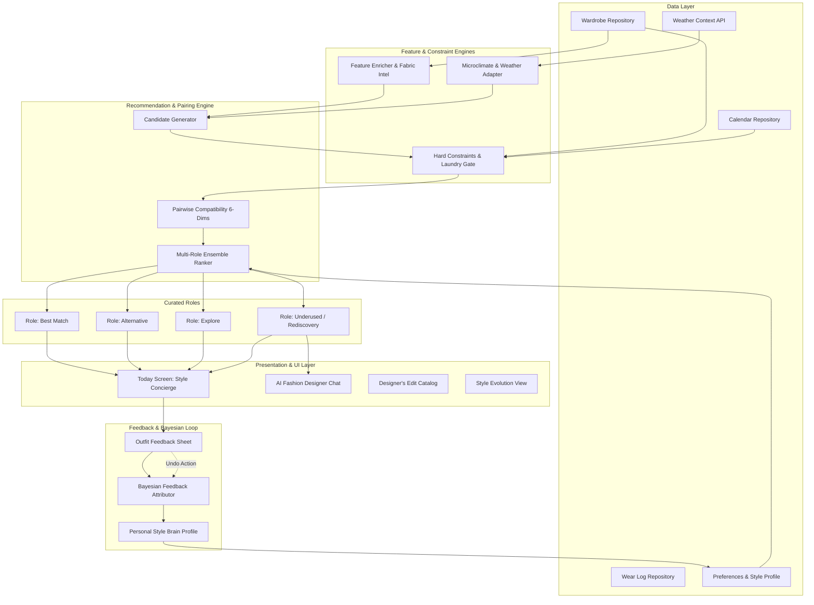

# StyleSaathi 4.0 — Real-Time Personal Fashion Intelligence Architecture

## 1. Executive Summary

StyleSaathi 4.0 evolves the application into an AI-powered personal fashion designer, wardrobe intelligence system, and daily styling companion. Unlike generic chatbots that simulate fashion advice by querying external language models with unpredictable hallucinations and recurring API costs, StyleSaathi operates on an authoritative, deterministic, local-first intelligence architecture with **₹0 operating cost** and zero external data exfiltration.

The intelligence framework synthesizes 12 foundational engineering pillars into a cohesive, context-aware styling engine. It combines Bayesian preference learning, multi-dimensional pairwise harmony, regional Indian textile traditions, microclimate weather adaptation, and real-time wear lifecycle tracking.

---

## 2. Audit of the 12 Foundational Intelligence Pillars

```
+---------------------------------------------------------------------------------------------------+
|                                     STYLESAATHI 4.0 INTELLIGENCE CORE                             |
+---------------------------------------------------------------------------------------------------+
|  1. Style Brain (Bayesian Decay)       7. Microclimate & Weather Adapter    10. Hard Constraints  |
|  2. Feedback Attribution (6 Axes)      8. Outfit Calendar Architecture      11. Attributed Loop   |
|  3. Feature Intelligence (Fabrics)     9. Wear Tracking & Analytics         12. AI Saathi & Sync  |
|  4. Pairwise Compatibility (6 Dims)    5. Ensemble Graph & Multi-Role Rank   6. Shadow Evaluation |
+---------------------------------------------------------------------------------------------------+
```

### Pillar 1: Personal Style Profile Engine
- **Module Path:** `src/engine/styleBrain.ts`
- **Core Responsibility:** Evaluates user aesthetic affinity scores across color palettes, silhouettes, formality levels, fabric textures, and category combinations.
- **Algorithm & Principles:**
  - Implements half-life decay (30 days) to prevent historical wear patterns from locking the user into obsolete preferences.
  - Maintains beta distributions for observed preference categories, dynamically weighing positive affirmations (`+0.35`) against negative rejections (`-0.50`).
  - Scales preferences into normalized affinity vectors $[-1.0, +1.0]$.
  - Cold-start handling: safely falls back to neutral priors ($0.0$) when user wear history is below $N = 5$.

### Pillar 2: Bayesian Preference Learning
- **Module Path:** `src/engine/feedback/feedbackAttributor.ts`
- **Core Responsibility:** Translates user feedback on complete looks into specific garment, color, and silhouette attribute updates.
- **Algorithm & Principles:**
  - Employs feature dampening to prevent a single negative reaction from permanently blacklisting a versatile garment.
  - Granular weight adjustments across 6 distinct attribute axes: color, formality, fit/silhouette, fabric weight, pattern density, and cultural alignment.
  - Deduplication window prevents rapid repetitive tap feedback from skewing the underlying probability model.

### Pillar 3: Wardrobe Feature Intelligence
- **Module Path:** `src/engine/features/` & `src/engine/fabricIntelligence.ts` & `src/engine/patternIntelligence.ts`
- **Core Responsibility:** Deep metadata enrichment for every wardrobe garment.
- **Algorithm & Principles:**
  - Fabric breathability and thermal conductivity scoring (e.g., Khadi/Linen: high breathability, low thermal retention; Wool/Velvet: low breathability, high thermal insulation).
  - Pattern scale and visual density analysis: classifies patterns into micro-print, bold check, stripe, solid, or ornate jacquard/brocade.
  - Optical silhouette classification: tracks garment volume (fitted, relaxed, oversized, fluid, architectural).

### Pillar 4: Pairwise Compatibility Engine
- **Module Path:** `src/engine/pairwise/`
- **Core Responsibility:** Computes mutual harmony scores between any two garments across 6 physical and aesthetic dimensions.
- **Dimensions & Scoring:**
  - **Color Harmony:** Analogous, complementary, monochromatic, and neutral anchor harmony matrices ($0.0 - 1.0$).
  - **Fabric Weight & Texture:** Prevents dissonant pairings (e.g., heavy winter tweed blazer over flimsy sheer chiffon).
  - **Formality Alignment:** Computes Euclidean distance between garment formality ratings ($1.0 - 5.0$).
  - **Silhouette Balance:** Enforces proportional balance (e.g., fitted top + flared bottom, relaxed top + tailored trousers).
  - **Pattern Compatibility:** Limits high-contrast pattern collisions (e.g., bold stripes paired with busy floral prints).
  - **Cultural & Regional Harmony:** Enforces authentic pairing rules (e.g., Kurta + Churidar / Nehru Jacket / Tapered Trousers).

### Pillar 5: Ensemble Graph & Multi-Role Ranking
- **Module Path:** `src/engine/ensemble/` & `src/engine/recommendationEngine.ts`
- **Core Responsibility:** Generates, filters, scores, and curates multi-garment ensembles for daily styling.
- **Curation Roles:**
  1. `best_match`: Top-scoring candidate matching current weather, occasion, and personal style affinity.
  2. `alternative`: Divergent styling route (outfit distance $\ge 0.35$ from Best Match) providing genuine choice.
  3. `explore`: Controlled novelty candidate pushing boundary within safe affinity margins using deterministic hashing.
  4. `underused`: (StyleSaathi 4.0 expansion) Promotes neglected wardrobe gems ($wearCount \le 1$) with high pairwise affinity to revive dormant closet equity.

### Pillar 6: Shadow Evaluation & Metric Telemetry
- **Module Path:** `src/engine/ensemble/shadowEvaluator.ts`
- **Core Responsibility:** Evaluates experimental scoring adjustments and heuristics in parallel without mutating user-facing recommendations.
- **Telemetry Collected:** Candidate generation latency, hard-filter rejection rates, graph density, and comparative rank-order correlation.

### Pillar 7: Weather & Microclimate Adapter
- **Module Path:** `src/engine/ensemble/microclimateAdapter.ts` & `src/context/WeatherContext.tsx`
- **Core Responsibility:** Modulates ensemble scores according to real-time atmospheric conditions.
- **Adaptation Rules:**
  - High Temperature ($> 30^\circ\text{C}$): Heavily penalizes synthetic polyesters, dark heat-absorbing colors, and rigid multi-layering; boosts linen, mulmul, and cotton.
  - Rain / Precipitation: Strictly filters floor-sweeping hems (palazzos, dhotis, trailing skirts) and water-vulnerable fabrics (suede, raw silk); prioritizes ankle-length crops and weather-resistant footwear.
  - Cold / Low Temperature ($< 18^\circ\text{C}$): Enforces thermal layering (jackets, blazers, cardigans, wool blends).

### Pillar 8: Outfit Calendar & Planning Architecture
- **Module Path:** `src/repositories/LocalStorageCalendarRepository.ts`
- **Core Responsibility:** Multi-day outfit scheduling with planning-mode exemptions.
- **Rules:**
  - Planning mode allows scheduling garments currently in laundry if the event date is $\ge 2$ days out (allowing wash cycle completion).
  - Immediate wear prevents scheduling dirty garments for today.
  - Anti-repetition: Prevents recommending pieces scheduled for tomorrow or worn in the previous 72 hours.

### Pillar 9: Wear Tracking & Rotation Analytics
- **Module Path:** `src/repositories/LocalStorageWearEventsRepository.ts` & `src/engine/analytics/`
- **Core Responsibility:** Tracks garment wear timestamps, wear frequencies, cost-per-wear amortizations, and closet rotation health.
- **Metrics:** Identifies dormant garments (unworn for $> 45$ days), rotation balance index, and dominant color palette distribution.

### Pillar 10: Laundry Validation & Hard Constraints
- **Module Path:** `src/engine/hardConstraints.ts`
- **Core Responsibility:** Zero-compromise gatekeeper filtering unviable outfits before scoring.
- **Constraints Checked:**
  - Laundry status (garment must be clean for same-day wear).
  - Cultural decorum / Modesty filters (e.g., puja requirements, institutional dress codes).
  - Structural completeness (e.g., Saree requires Blouse; Kurta requires Bottom; Suit requires Formal Shoes).

### Pillar 11: Outfit Saving & Attributed Feedback Loop
- **Module Path:** `src/engine/feedback/feedbackAttributor.ts`
- **Core Responsibility:** Captures user reactions (Love, Dislike, Rejection reasons) and attributes feedback to specific features with immediate rollback/undo capabilities.

### Pillar 12: AI Saathi & Local-First Sync Architecture
- **Module Path:** `src/engine/saathi/` & `src/lib/sync/`
- **Core Responsibility:** Conversational intent orchestration, bounded turn state, and offline-first IndexedDB persistence with background cloud reconciliation.

---

## 3. StyleSaathi 4.0 Capability Matrix & Gap Analysis

| Capability | StyleSaathi 3.x State | StyleSaathi 4.0 Requirement | Architectural Status |
| :--- | :--- | :--- | :--- |
| **Daily Style Concierge** | Static outfit suggestions on Today screen | Real-time context awareness: weather freshness, event timing, calendar lookahead, dynamic styling tips | Enhanced in `TodayScreen.tsx` & `recommendationEngine.ts` |
| **Recommendation Diversity** | 3 roles (`best_match`, `alternative`, `explore`) | 4 roles including `underused` to resurface dormant closet items; anti-repetition lookback | Added `underused` role and repetition penalty |
| **Conversational AI Designer** | Basic intent routing (12 intents) | 10 specialized fashion queries with strict 8-part editorial reasoning format & 100% wardrobe grounding | Expanded `intentParser.ts`, `types.ts`, and `orchestrationEngine.ts` |
| **Editorial Fashion Knowledge** | Basic rules registry | Curated Designer's Edit: 5 philosophies (Quiet Luxury, Indian Heritage, Indo-Western, Contemporary Tailoring, Minimalist) | Implemented in `src/engine/knowledge/designersEditCatalog.ts` |
| **Granular Feedback Sheet** | Binary thumbs up/down | 7-point rejection reasons (Too formal, Too casual, Wrong color, Not weather appropriate, Already worn, Change garment, Not my style) with undo | Built `OutfitFeedbackSheet.tsx` with Bayesian integration |
| **Style Evolution Analytics** | Basic wear counts | Interactive Personal Style Evolution dashboard: silhouette distribution, color palette affinity, underused items, sample-size safeguards | Built `PersonalStyleEvolutionView.tsx` |

---

## 4. End-to-End Intelligence Data Flow



---

## 5. Architectural Guarantees & Constraints

1. **₹0 Compute / API Cost:** All intelligence, graph searches, Bayesian inference, and intent parsing execute in-browser and on-device. No calls to paid LLM providers.
2. **Deterministic & Reproducible:** Seeds and tie-breakers are deterministically generated from user wardrobe fingerprints, date stamps, and offset vectors.
3. **Strict Wardrobe Grounding:** Every recommended outfit, piece, and styling variation references real items in the user's wardrobe. The engine never invents or hallucinates unowned items.
4. **Resilience & Privacy:** Offline-first IndexedDB storage guarantees continuous functionality without internet connectivity. No biometric or personal style data leaves the user's device without end-to-end user-authorized sync.

