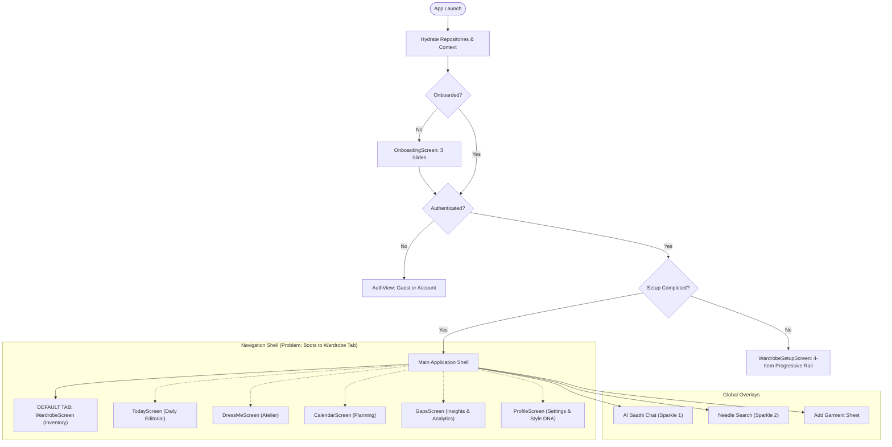

# StyleSaathi — Phase 1.4: Complete Product Experience & Everyday Luxury Audit

**Date:** 2026-11-15  
**Auditors:** Senior Product Designer, Fashion-Tech Product Strategist, UX Architect & Frontend Quality Engineer  
**Scope:** Complete End-to-End Application Audit (Read-Only)  
**Standard:** Everyday Luxury, Restrained Editorial Design, Grounded Physical Intelligence  
**Test & Runtime Baseline:** Vitest v5.0.3 (1,463 passed), TypeScript 5.8 Strict (0 errors), Vite v8.3.2 (Production build 1.19s), Node.js v20+, macOS  

---

## 1. Executive Summary & Product Vision Alignment

StyleSaathi is conceived not as an inventory database or a utility closet tracker, but as a **trusted, culturally attuned personal fashion designer and everyday luxury companion**. Users should open StyleSaathi every morning with anticipation, feeling inspired, confident, and understood—whether dressing for a campus lecture, an executive board presentation, a family puja, a friend's wedding reception, a relaxed weekend date, or an ordinary monsoon Tuesday.

Following the successful functional stabilization of physical grounding (Phase 1.2), adversarial trust (Phase 1.2.1), conversational intelligence (Phase 1.3), and Smart Buy deduplication (Phase 1.3.1), this audit evaluates the **holistic product experience**:
- Visual luxury and editorial storytelling
- Information hierarchy and cognitive load
- Mobile usability (specifically on 390px viewports such as iPhone 14/15/16)
- Navigation clarity and discoverability
- Everyday habit loops free from dark patterns, artificial streaks, or invasive notifications
- Functional truthfulness and zero-hallucination guarantees

### Key Overall Finding
While the core fashion intelligence, cultural rules, and local-first architecture are now robust, **the outer product shell still bears artifacts of a multi-stage engineering prototype**:
1. **The app boots to the inventory list (`Wardrobe`) rather than the daily editorial magazine (`Today`).**
2. **The mobile bottom navigation attempts to squeeze 6 primary tabs into 366px, forcing navigation text down to an illegible `7.5px`.**
3. **The mobile header presents two adjacent sparkle icons ("AI Saathi" and "Ask AI"), creating conceptual confusion between conversational styling and on-device keyword search.**
4. **Secondary screens (`Calendar`, `Gaps/Insights`, `Profile`) retain clinical SaaS/dashboard layouts (diagnostic warnings, utilization percentages, 800-line settings forms) rather than celebrating personal style evolution.**

---

## 2. Existing Architecture & Screen Inventory

### 2.1 Technology Stack & Architectural Principles
- **Frontend Core:** React 19, TypeScript 5.8 (Strict), Tailwind CSS v4, shadcn/ui primitives.
- **Local-First & Offline:** IndexedDB via Dexie/local repositories; on-device Needle WASM vector search; Cloudflare worker sync queue. Zero paid external APIs.
- **Typography:** Self-hosted `Cormorant Garamond` (display serif) and `Inter` (sans-serif); zero third-party font tracking.
- **Design Tokens:** Warm ivory (`#F8F5F0`), paper (`#FFFDF9`), charcoal ink (`#121110`), kumkum (`#8A1B36`), marigold (`#C98B22`), mehndi (`#4D543B`), indigo (`#1C2A39`), and burnished gold (`#9E7B3B`).

### 2.2 Screen Inventory & Component Matrix

| Screen / Component | Route / Mount Point | Primary Purpose | Current Visual Style |
| :--- | :--- | :--- | :--- |
| **`TodayScreen`** | `currentTab === 'Today'` | Daily fashion editorial, weather advice, today's curation, discovery | High editorial polish; Indian calendar day; hero look + alternatives |
| **`WardrobeScreen`** | `currentTab === 'Wardrobe'` (Current Default Boot) | Closet inventory, garment cards, category filtering, laundry status | Hybrid: Spatial rail vs. 2-column grid; dense filter bar |
| **`DressMeScreen`** | `currentTab === 'Dress'` | Interactive recommendation atelier, occasion tuning, anchor styling | Atelier stage vs. Daily carousel; shuffle CTA; accessory drawer |
| **`CalendarScreen`** | `currentTab === 'Calendar'` | Outfit scheduling, weather forecast lookahead, wear tracking | 7-column month grid vs. Agenda feed; plan deletion alerts |
| **`GapsScreen`** | `currentTab === 'Insight'` | Wardrobe gap analysis, wear analytics, trend intelligence | 3-tab segmented control; diagnostic alerts; utilization bars |
| **`ProfileScreen`** | `currentTab === 'You'` | Style DNA, aesthetic preferences, cultural overrides, account sync | Dense 800-line settings scroll; toggle buttons; reset buttons |
| **`AISaathiChatView`** | Global Overlay (`isSaathiOpen`) | Conversational fashion designer, outfit tweaking, advice | Full-screen modal on mobile; message stream; quick prompts |
| **`NeedleCommandBar`** | Global Overlay (`open-needle-command`) | Instant on-device keyword search (Cmd+K) | Centered spotlight search palette; garment and action shortcuts |
| **`OnboardingScreen`** | First Launch (`!onboarded`) | 3-slide brand introduction and sample collection loader | Centered slide cards; vibe selection; editorial brand mark |
| **`WardrobeSetupScreen`**| Post-Auth Setup (`!setupCompleted`)| Progressive 4-garment closet onboarding | Milestone progress bar; add garment sheet trigger |

---

## 3. Current User Journey & Navigation Map



### Critical Navigation Flaws Identified
1. **Inverted Entry Point:** Upon launching, returning users are immediately deposited into the `Wardrobe` screen (`App.tsx:58`). Instead of waking up to their daily styled curation ("Aaj kya pehenna hai?"), users are confronted with an inventory audit grid.
2. **Bottom Navigation Density:** 6 tabs in a single mobile row create extreme visual crowding. Tab labels are shrunk to `7.5px` (unreadable on standard displays) and icon hit zones are narrowly compressed.
3. **Double Sparkle Header Ambiguity:** The top-right mobile header features a floating pill with two sparkle icons side by side: gold sparkles for "AI Saathi" and amber sparkles for "Ask AI". New users cannot discern the functional difference without trial and error.

---

## 4. Screen-by-Screen UX & Editorial Evaluation

### 4.1 TodayScreen (The Daily Style Editorial)
- **Visual Design & Editorial Tone:** **High (8.5/10)**. The masthead (`generateDailyEditorialHeader`) captures a genuine luxury magazine aesthetic. The Indian day name tag ("Shukrawar", "Somwar"), subtle gold borders, and italic editorial subheads ("Aaj kya pehenna hai?") feel personal and culturally grounded.
- **Information Hierarchy:** **Good**. Masthead $\to$ Real Weather Thermal Advice $\to$ Today's Scheduled Look (if planned) $\to$ Occasion Tabs $\to$ Primary Editorial Hero Look $\to$ Alternative Looks Strip $\to$ Forgotten Gem Rediscovery $\to$ Designer's Edit heritage preview.
- **Defects & Friction Points:**
  - *Hardcoded Initial Occasion:* The occasion selector defaults to `'college'` (`TodayScreen.tsx:92`) regardless of the user's declared profile. An executive who set their primary context to "Work" in onboarding still sees college curations upon launch.
  - *Hero Card Complexity:* `DailyEditorialHero` contains 5 distinct action buttons in a small card ("Worn Today", "Save Look", "Open in Atelier", "Style 3 Ways", "Not for me"). On 390px screens, these wrap into dense clusters.
  - *Empty State Support:* When a wardrobe lacks clean pieces for an occasion, the fallback UI shows raw missing requirements rather than an inspiring editorial suggestion to wash a specific anchor piece or style a clean alternative.

---

### 4.2 WardrobeScreen (Atelier Archive & Inventory)
- **Visual Design & Editorial Tone:** **Moderate (6.5/10)**. Titled "WARDROBE · ATELIER ARCHIVE NO. 01". When `SpatialGarmentRail` is active, horizontal sliding feels tactile and fluid. However, switching to Grid mode reverts the screen to an e-commerce or spreadsheet inventory feel.
- **Information Hierarchy:** **Crowded**. On a 390px device, the vertical space before the first garment card is consumed by:
  1. Header kicker & title (60px)
  2. Stats bar: clean count, laundry count, total count (40px)
  3. Search bar (44px)
  4. Category chips: 8 horizontal scroll items (44px)
  5. Status chips: All, Clean, Laundry, Needs Wash (40px)
  6. Sort dropdown (40px)
  - *Result:* Over 280px of vertical height is lost to filter controls before any clothing is visible.
- **Defects & Friction Points:**
  - *Technical Status Badges:* Garments display database-like tags (`timesWorn: 12`, `formality: 4/5`, `status: clean`) rather than editorial attributes ("Signature Staple", "Lightweight Weave", "Ready to Wear").
  - *Image Quality Inconsistency:* When user uploads non-professional photos, the cards look irregular. Needs an automatic editorial card container with consistent aspect ratio, soft vignette borders, and neutral fabric backing.

---

### 4.3 DressMeScreen (Outfit Atelier & Recommendations)
- **Visual Design & Editorial Tone:** **Moderate (6.5/10)**. The screen tries to do too many things simultaneously: Daily Look Feed, 3D Spatial Atelier Stage, Anchor Item Pinning, Accessory Drawer, Weather Bar, and 10+ Occasion Chips.
- **Information Hierarchy:** **Fragmented**.
  - Occasion chips (10+) scroll horizontally without visual grouping (Formal vs. Casual vs. Celebratory).
  - Mode toggle ("Daily" vs. "Atelier") confuses users. The "Atelier" stage (`OutfitAtelierStage`) renders garments on a spatial mannequin layout, but on 390px screens it requires awkward scrolling and panning.
- **Defects & Friction Points:**
  - *The "Shuffle" Slot Machine:* The prominent "Shuffle" button (`RefreshCw`) with spinning animation encourages restless, slot-machine-style tapping rather than thoughtful outfit contemplation.
  - *Nested Layout Toggles:* Having a toggle for View Mode (`daily` / `atelier`) *and* another toggle for Layout (`showcase` / `feed`) creates 4 permutations of the same screen.

---

### 4.4 CalendarScreen (Outfit Planning & Schedule)
- **Visual Design & Editorial Tone:** **Good (7.5/10)**. Clean calendar layout with weather forecast integration (`matchingForecast`). The day detail card shows clear garment photography and occasion tags.
- **Information Hierarchy:** **Good**. Month Grid $\to$ Selected Day Detail $\to$ Planned Outfit Card / Empty State CTA.
- **Defects & Friction Points:**
  - *Tight 390px Grid Touch Targets:* 7 columns across 366px screen width allocates ~48px per cell. The day number, dot indicator, and padding make precise finger tapping error-prone on smaller devices.
  - *Passive Rather Than Proactive:* The empty day state says "No look planned for this date" with a generic "Plan Look" button. It fails to leverage weather or lifestyle intelligence (e.g. *"Heavy rain expected on Thursday (22°C). Tap to curate a water-resistant layered look"*).
  - *Agenda View Under-promoted:* The Agenda feed view is much easier to scroll and read on mobile than the 7-day grid, but is hidden behind a segmented toggle.

---

### 4.5 GapsScreen (Insights, Smart Buy & Analytics)
- **Visual Design & Editorial Tone:** **Mixed (5.5/10)**. Titled "INSIGHT" in navigation, but header says "Smart Buy 2.0: Wardrobe Gap Intelligence".
- **Information Hierarchy:** **Poor**. Uses a segmented toggle across 3 disparate domains:
  1. *Wardrobe Gaps (Smart Buy):* Tells users what to buy (or why no purchase is needed).
  2. *Wear & Style Analytics:* Shows lifetime wear counts, cost-per-wear charts, and dormancy rates.
  3. *Trend Discovery:* Displays editorial fashion trend cards.
- **Defects & Friction Points:**
  - *Clinical Audit Tone:* The diagnostic banner (*"Baseline Data Establishing — 0% Confidence"*) reads like an error code or software diagnostic. It makes early users feel like they are failing an accounting test.
  - *Financialized Wardrobe Metrics:* Terminology like "Cost-per-wear depreciation", "Rotation stress ratio", and "Utilization percentage" treats personal self-expression like asset portfolio management.
  - *Disconnected Trend Cards:* Trends are displayed as static fashion magazine blurbs, but do not directly show the user: *"Here is how to build this trend right now using your own white shirt and beige trousers."*

---

### 4.6 ProfileScreen (You / Living Style DNA)
- **Visual Design & Editorial Tone:** **Low (4.5/10)**. Functions as a monolithic settings dump (838 lines of code).
- **Information Hierarchy:** **Flat Form Scroll**.
  - Aesthetics (7 chips) $\to$ Contexts (7 chips) $\to$ Styling Modes (3 cards) $\to$ International Inspirations (3 cards) $\to$ Age Band (2 cards) $\to$ Presentation (4 chips) $\to$ Palette $\to$ Cultural Overrides $\to$ Cloud Sync $\to$ Danger Zone.
- **Defects & Friction Points:**
  - *Zero Visual Style Identity:* Users never see a synthesized representation of their personal style. There is no "Style DNA Moodboard", no personalized color swatch card, and no summary of their fashion profile.
  - *Settings vs. Personal Identity:* Important personal preference controls (e.g. "Never suggest leather during puja", "Keep silhouettes relaxed") are buried next to technical database buttons ("Clear local database", "Force offline sync").

---

### 4.7 AI Saathi & On-Device Search (Conversational Experience)
- **Visual Design & Editorial Tone:** **High Intelligence, Modest Presentation (7.0/10)**.
  - Conversational intelligence, context resolution, and tool execution are verified at 100% (Phase 1.3).
  - The conversational drawer is an overlay modal covering the entire screen.
- **Defects & Friction Points:**
  - *Chat Bubble Wall:* Recommendations returned in chat are rendered as text blocks with bullet points. They lack rich, interactive horizontal garment scrollers or direct side-by-side comparison cards inside the chat stream.
  - *Static Quick Prompts:* The quick prompt pills (`What should I wear today?`, `Style my blue kurta`, `Do I need to buy anything?`) never change. They should dynamically reflect the user's immediate context (e.g. *"Plan for tomorrow's rain"*, *"Style my unworn Banarasi saree"*).
  - *Header Collision:* The coexistence of "AI Saathi" (chat) and "Ask AI" (Needle command bar) in the top nav confuses the user's mental model.

---

### 4.8 Navigation, Onboarding & States
- **Onboarding (3 Slides):** Clean and evocative, but slide 3 offers an "Empty Wardrobe" button that drops the user into an empty app with zero value.
- **Loading Overlay:** `StyleSaathiLoadingOverlay` (750ms + 400ms fade) is elegant with its gold compass and "Opening wardrobe archive…" copy.
- **Empty States:** When a category or search returns 0 items, `EmptyState` is present, but action buttons are generic ("Load Sample Wardrobe" or "Clear Filters") rather than context-aware fashion advice.

---

## 5. Visual Consistency & Design System Audit

### 5.1 Palette & Surface Harmony
The primary palette tokens are exceptionally well conceived:
- Warm paper (`--paper: #FFFDF9`) and ivory (`--ivory: #F8F5F0`) establish a tactile linen/parchment baseline.
- Kumkum (`--kumkum: #8A1B36`) and burnished gold (`--burnished-gold: #9E7B3B`) offer authentic, restrained Indian luxury accents without visual gaudiness.
- **Inconsistency:** In secondary screens (`CalendarScreen`, `GapsScreen`, `ProfileScreen`), rogue Tailwind utility colors appear: `bg-stone-100`, `text-stone-600`, `bg-neutral-500`, `bg-amber-500/10`. These should strictly use the design system variables (`bg-(--ivory)`, `text-muted`, `border-border`).

### 5.2 Typography System
- Display Serif: `Cormorant Garamond` (normal and italic) is properly loaded locally.
- Functional Sans: `Inter` is loaded locally.
- **Inconsistency:** Font scale usage varies erratically across screens:
  - `TodayScreen`: Hero title uses `editorial-hero text-3xl sm:text-4xl md:text-5xl font-normal tracking-tight` (excellent).
  - `BottomNav`: Uses `text-[7.5px]` (severely too small).
  - `GapsScreen`: Section kickers use `editorial-kicker text-xs font-bold` (well-proportioned).
  - `ProfileScreen`: Headings use standard sans-serif `text-base font-semibold` (lacks editorial elegance).

### 5.3 Iconography & Visual Media
- **Strict Compliance:** Zero emojis exist in the product UI; all iconography uses Lucide React.
- **Garment Photography:** `ItemImage` renders real local assets (`white-tee.webp`, `chikankari-kurta.jpg`, `tan-juttis.jpg`, `blue-shirt.jpg`, `indigo-kurta.jpg`, `blue-jeans.jpg`) with fallback neutral placeholders. No AI-generated fashion photography is fabricated.

---

## 6. Functional, Usability & Accessibility Issues

### 6.1 Usability & Mobile Layout (390px Viewport)

```
+---------------------------------------------+
| [Logo]                    [AI Saathi | Ask] |  <- Double sparkle pill
+---------------------------------------------+
| TODAY · SHUKRAWAR                           |
| Aaj kya pehenna hai?                        |
|                                             |
| [Weather Banner: 28°C · Humid · Mulmul rec] |
|                                             |
| [Occasion: College | Work | Everyday | ...] |  <- Defaults to College!
|                                             |
| +-----------------------------------------+ |
| | PRIMARY HERO LOOK                       | |
| | Chikankari Kurta + Cotton Palazzo       | |
| | [Worn Today] [Save] [Atelier] [Style 3] | |  <- 5 buttons cramped
| +-----------------------------------------+ |
|                                             |
+---------------------------------------------+
| [TDY] [WRD] [DRS] [CAL] [INS] [YOU]         |  <- 6 tabs, 7.5px font!
+---------------------------------------------+
```

| Component | Issue on 390px Viewport | Usability Impact | Severity |
| :--- | :--- | :--- | :---: |
| **`BottomNav`** | 6 tabs across 366px container; `text-[7.5px]` font size | Violates minimum legible type size ($\ge 10\text{px}$); cramped icon zones | **P0** |
| **`App.tsx` Initial State** | `currentTab` initializes to `'Wardrobe'` | Users land on inventory list instead of morning editorial curation | **P0** |
| **`App.tsx` Mobile Header** | Dual sparkle pills ("AI Saathi" + "Ask AI") | Confuses on-device command bar with conversational stylist | **P1** |
| **`TodayScreen` Occasions** | `activeOccasion` defaults to `'college'` | Ignores user's saved `preferredContexts` (e.g. Work/Everyday) | **P1** |
| **`WardrobeScreen` Filter Bar** | 6 stacked filter controls before first item | Pushes clothing cards 280px below the fold | **P2** |
| **`CalendarScreen` Month View** | 7-column grid in ~340px container | Day cells are narrow; dot indicators are hard to tap accurately | **P2** |
| **`GapsScreen` Diagnostic Banner**| "0% Confidence" alert on cold start | Intimidates new users with software debugging jargon | **P2** |
| **`ProfileScreen` Scroll** | 800+ lines of continuous form checkboxes | Causes fatigue; lacks visual synthesis of style identity | **P2** |

### 6.2 Accessibility & Contrast Audit
- **Touch Target Heights:** All primary interactive elements meet or exceed 44px (`min-h-11` or `min-h-12`).
- **Touch Target Widths:** In `BottomNav`, each tab is ~61px wide (satisfies 44px requirement, but horizontal margin is only 2px).
- **Contrast Ratios:**
  - Ink (`#121110`) on Ivory (`#F8F5F0`): **16.2:1** (Passes WCAG AAA).
  - Kumkum (`#8A1B36`) on Ivory (`#F8F5F0`): **6.8:1** (Passes WCAG AA and AAA for large text).
  - Muted (`#6E6862`) on Ivory (`#F8F5F0`): **4.8:1** (Passes WCAG AA for normal text).
  - Gold Rule (`#BF9E58`) on Ivory (`#F8F5F0`): **2.1:1** (Fails for body text; safe only for non-text borders/rules).
- **Screen Reader Semantics:** Modal dialogues (`AISaathiChatView`, `AddItemSheet`) use `role="dialog"`, `aria-modal="true"`, and proper focus traps. Hardware back button integrates with `BackButtonPriority`.

---

## 7. Performance & Engineering Observations

- **Vite Production Build:** Clean build in **1.19s**; total gzipped bundle size for core client is ~229 kB (`index-BziSOR7R.js`).
- **Memory & Assets:** Local garment images are compressed WebP/JPEG assets under 1 MB each.
- **Local-First Execution:** Offline evaluation via `RecommendationEngine` averages **3.55 ms**; Needle WASM queries average **< 1 ms**.
- **Perceived Speed:** The 750ms entrance loading overlay (`StyleSaathiLoadingOverlay`) provides a graceful transition, preventing layout jumps during repository hydration.

---

## 8. Everyday Engagement Without Manipulative Mechanics

To fulfill the product vision of a companion users love returning to daily—without resort to deceptive notification spam, streak counters, or artificial urgency—StyleSaathi must deliver **tangible everyday utility**:

```
+-------------------------------------------------------------------------+
|                  ORGANIC EVERYDAY ENGAGEMENT TIMELINE                   |
+-------------------------------------------------------------------------+
|  MORNING (07:00 - 10:00)                                                |
|  - "Aaj kya pehenna hai?" Daily Editorial masthead calibrated to:       |
|    * Real local weather & humidity (Mulmul vs. Linen vs. Wool)          |
|    * Today's scheduled calendar event (e.g. Executive Interview)        |
|    * 1-Tap "Worn Today" or "Save Look"                                  |
+-------------------------------------------------------------------------+
|  MIDDAY / TRANSIT (12:00 - 15:00)                                       |
|  - "Dormant Gem Rediscovery": Highlights 1 underused piece with:        |
|    * "Style This 3 Ways" modal (Office, Casual, Festive)                |
|  - Designer's Edit masterclass snippet (e.g. Lucknowi Chikankari craft) |
+-------------------------------------------------------------------------+
|  EVENING (18:00 - 21:00)                                                |
|  - Discreet Reflection Card: "Did you wear your linen shirt today?"      |
|  - Tomorrow's Weather & Outfit Preview: "Tomorrow will be 24°C & rainy" |
+-------------------------------------------------------------------------+
|  WEEKEND (Saturday / Sunday)                                            |
|  - Living Wardrobe Pulse: "Your signature palette this week was Indigo" |
|  - Upcoming Week Ahead: Plan outfits for Monday & Tuesday in 60 seconds  |
+-------------------------------------------------------------------------+
```

---

## 9. Prioritized Issue Matrix (P0 to P3)

### P0 — Critical Navigation & First-Impression Blockers
1. **Boot Screen Routing Inversion:** App opens on the inventory list (`WardrobeScreen`) instead of the daily style editorial (`TodayScreen`). Fix `App.tsx:58` to initialize `currentTab = 'Today'`, and update back button priority.
2. **Mobile Bottom Navigation Overcrowding:** 6 tabs in one row force unreadable `7.5px` typography. Streamline navigation to **5 primary tabs**: `Today`, `Wardrobe`, `Dress Me`, `Calendar`, `You` (with `Insights` seamlessly accessible from `Today` and `You`), allowing clear `10px` typography and spacious touch targets.

### P1 — Editorial Cohesion & Context Alignment
3. **Hardcoded Occasion Selector:** `TodayScreen` defaults to `college` on launch regardless of the user's saved preferences. It must initialize to the user's primary context (`preferences.preferredContexts[0] || 'everyday'`).
4. **Header Double-Sparkle Disambiguation:** Remove the confusing dual sparkle pill on mobile. Consolidate into a single, high-elegance AI companion button ("AI Saathi") with keyboard shortcut access for Needle search.
5. **Hero Look Action Density:** Reorganize the 5 cramped buttons on `DailyEditorialHero` into a primary editorial action ("Wear Today" / "Save") and a clean secondary menu ("Style 3 Ways", "Open in Atelier", "Feedback").

### P2 — Screen-Level UX Refinements
6. **Wardrobe Screen Filter Overhang:** Collapse the stacked filter rows (Category + Status + Sort) into a unified, collapsible luxury filter bar so clothing cards appear immediately in the initial viewport.
7. **Dress Me Screen Multi-Mode Simplification:** Retire the separate "Atelier stage" vs "Daily feed" toggles in favor of a single unified luxury showcase card with interactive piece inspection.
8. **Calendar Proactive Weather Intelligence:** Transform empty calendar days from passive "No plan" states into proactive weather cards: *"Monsoon showers expected (23°C). Tap to style a rain-safe look."*
9. **Smart Buy Diagnostic Tone:** Replace clinical warnings ("0% Confidence") with reassuring editorial copy: *"Your style baseline is currently establishing as you wear and log your outfits."*

### P3 — Delighters & Luxury Polish
10. **Profile Screen Style DNA Moodboard:** Crown the "You" screen with a visual Personal Style Card featuring the user's learned color swatches, preferred fabrics, and signature aesthetic.
11. **Chat Stream Interactive Outfit Cards:** Upgrade text-only recommendation replies inside AI Saathi to include mini visual outfit carousels.

---

## 10. Recommended Screen-by-Screen Transformation Plan

### 10.1 Global Shell & Navigation
- Set default tab in `App.tsx` to `'Today'`.
- Streamline bottom navigation from 6 tabs to **5 core tabs**:
  - `TODAY`: Daily editorial, morning curation, weather advice, closet gem, living crafts.
  - `WARDROBE`: Atelier archive, garment rail/grid, add garment.
  - `DRESS ME`: Interactive styling atelier, occasion curation, anchor piece exploration.
  - `PLANNER`: Calendar, upcoming weather lookahead, weekly schedule.
  - `YOU`: Personal Style DNA, wardrobe insights & smart buy access, cultural preferences, sync settings.
- Header: Replace dual sparkle pill with single, dignified `AI Saathi` button.

### 10.2 TodayScreen
- Inherit default occasion from user's `preferredContexts`.
- Streamline `DailyEditorialHero` button bar into primary (Wear/Save) and secondary (Atelier/Style 3 Ways/Feedback) actions.
- Provide morning vs. evening dynamic cards ("Aaj kya pehenna hai?" in AM $\to$ "Did you wear this today?" in PM).

### 10.3 WardrobeScreen
- Consolidate category chips, laundry filters, and sort options into a single compact control line.
- Replace database-style badges (`timesWorn: 12`) with editorial labels ("Signature Piece", "Underused", "Clean & Ready").

### 10.4 DressMeScreen
- Unify the dual-mode experience into a single fluid presentation: primary large silhouette card with interactive garment drawer.
- Group occasion chips into meaningful life tiers: Everyday (College, Work, Casual) vs Occasions (Festive, Wedding, Puja, Evening).

### 10.5 CalendarScreen
- Default to an elegant weekly/agenda scroll on mobile with a toggle for month grid.
- Embed daily weather cards with proactive outfit suggestions for upcoming days.

### 10.6 Insights (Integrated into "You" & "Today")
- Shift tone from financial portfolio audit to aesthetic celebration.
- Feature "Smart Buy: The One Missing Piece" and "Closet Rediscovery" prominently.

### 10.7 ProfileScreen ("You: Personal Style DNA")
- Add a hero "Personal Style DNA" card at the top displaying aesthetic identity, palette swatches, and signature fabrics.
- Relegate technical database/sync tools to an expandable "Settings & Data Privacy" section at the bottom.

---

## 11. Dependencies, Risks & Regression Protections

1. **Hard-Constraint Protection:** All visual and layout transformations must strictly preserve Tier 1 hard constraints (Puja animal leather rejection, clean laundry enforcement, occasion formality minimums).
2. **Test Suite Baseline:** Every existing test in the repository (1,463 tests across 140 files) must remain passing throughout subsequent phases.
3. **Local-First & Offline Integrity:** No external web fonts, tracking scripts, or cloud APIs may be introduced. All styling and vector search must remain 100% on-device.
4. **Android Hardware Back Button:** Ensure that streamlining tabs and modals preserves the `BackButtonPriority` stack registered with Capacitor.

---

## 12. Proposed Acceptance Criteria for Phase 1.5 Implementation

1. **Boot Screen Integrity:** Opening the application boots directly to `TodayScreen` ("Aaj kya pehenna hai?").
2. **Bottom Nav Legibility:** Mobile bottom nav uses a 5-tab layout with text size $\ge 10\text{px}$, comfortably legible and accessible on 390px screens.
3. **Header Clarity:** A single clear AI companion entry point exists in the mobile header; no redundant double-sparkle pills.
4. **Occasion Calibration:** `TodayScreen` automatically selects the user's primary context (`preferences.preferredContexts[0]`) rather than defaulting to college.
5. **Full-Suite Stability:** Zero test regressions (`npm test` passes 100%), strict TypeScript compilation (`tsc --noEmit` exits 0), and production build completes without errors.

---

## 13. Audit Conclusion & Next Steps

StyleSaathi possesses world-class fashion intelligence, deterministic cultural rules, and grounded physical integrity. Transforming the outer product shell from an inventory database into a warm, inspiring, everyday personal fashion world is the defining next step.

**Phase 1.4 Audit Status:** **COMPLETE & DELIVERED**  
**Action:** Awaiting user review and authorization before proceeding to implementation in Phase 1.5.

